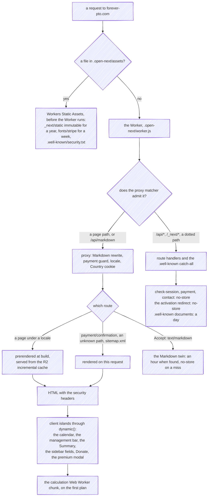

Caching happens at separate levels: an R2-backed incremental cache at the OpenNext/Workers level, and plain `Cache-Control` headers for the hashed build assets and the agent-facing markdown surface. Next's Cache Components are deliberately not another.

## What answers a request, and from where



- **The static layer answers first.** A path that matches a file OpenNext copied into `.open-next/assets` never reaches the Worker, which is why `apps/web/public/_headers` is the only place that can give those files a cache policy, and why `/.well-known/security.txt` is served from the file even though a `.well-known` route exists.
- **Every page is prerendered, bar three.** The `[locale]` pages are built once per deploy and read back from R2 on each request; the payment confirmation, the catch-all that answers an unknown path with its 404, and `sitemap.xml` render on the request. A path no locale claims and the proxy does not admit reaches `global-not-found.tsx`, prerendered once in English ([error pages](/architecture/error-pages/)).
- **The planner's interactive parts are client islands**, loaded through `dynamic()` after the HTML, so the first paint is the prerendered shell with skeletons, and the planner fills in as the islands and the stores arrive ([what runs where](/architecture/when-and-where/)).
- **The R2 entries are written at deploy time**, before the Worker is uploaded, under the build's own id, so the version being served always finds its own pages and a rollback finds the previous version's ([the OpenNext hand-off](/infra/workflows/#what-the-deploy-call-does-the-opennext-hand-off)).

## Cache Components are off

`next.config.ts` sets `cacheComponents: false`, and no file carries a `'use cache'` directive. The flag stays off because it hangs requests on the Workers runtime: with it on, and `cacheLife('days')` sites in `getCurrentYear`, `getPublicEnv` and the `Testimonials` section, production logs Next's *cannot guarantee that Cache Components will run as expected due to the current runtime's implementation of `setTimeout()`* warning followed by the runtime cancelling the request as hung, and the same thing reproduces locally on workerd. With it off every route answers in under a second with no errors. The evidence, the alternative that did not build and the cost are in [ADR 0015](https://github.com/fbuireu/forever-pto/blob/main/docs/adr/0015-cache-components-stay-off-on-the-workers-runtime.md).

What that means for rendering: the `[locale]` pages are plain SSG through `generateStaticParams`, built once per deploy, and the values a cached fragment would hold (the year, the public environment, the testimonials) are computed at build. `sitemap.ts` is the one route that opts into `export const dynamic = "force-dynamic"`, so a preview Worker names its own host. Re-enabling the flag is a decision that has to come with the ADR's reproduction run green on workerd.

## OpenNext incremental cache on R2

The app deploys to Cloudflare Workers via OpenNext. `open-next.config.ts` selects the R2 incremental cache:

```ts
import { defineCloudflareConfig } from '@opennextjs/cloudflare';
import r2IncrementalCache from '@opennextjs/cloudflare/overrides/incremental-cache/r2-incremental-cache';

export default defineCloudflareConfig({
  incrementalCache: r2IncrementalCache,
});
```

At runtime this is backed by the R2 bucket bound as `NEXT_INC_CACHE_R2_BUCKET` in `wrangler.toml`, with separate buckets per environment (see [environments](/infra/environments/)). Everything Next.js would put in its incremental cache (prerendered pages, fetch cache) is persisted there, so cache entries survive Worker isolate recycling and are shared across the fleet. The prerendered pages are not written by the Worker: `opennextjs-cloudflare deploy` writes them during the deploy, under `incremental-cache/<build id>/`, and fails the deploy when it cannot.

Next keys each entry by the route that owns it (`/route-cache/<kind>/<hash of the app entry>/$/<path>`), and OpenNext seeds the bucket from the build's prerendered pages under the key it computes, so the two have to agree. When they do not, every prerendered page misses, and because the root layout sets `dynamicParams = false`, Next answers that miss with its 404, on every page. That is why Next and the adapter move as a pair ([ADR 0009](https://github.com/fbuireu/forever-pto/blob/main/docs/adr/0009-next-16-2-pinned-by-the-cloudflare-adapter.md)), and why the preview's `e2e` run is where a mismatch shows: `next start` reads Next's own file-system cache and cannot.

## HTTP-level caches

- **The hashed build assets**: `apps/web/public/_headers` gives the `_next/static` tree `public, max-age=31536000, immutable`. Workers Static Assets serve every file with `max-age=0, must-revalidate` unless a `_headers` file in the assets directory says otherwise, so without that file every page load revalidates its 30 to 40 chunks, its CSS and its fonts, one round trip each. OpenNext copies `public/` into `.open-next/assets`, which is where the rule has to land. It covers that tree alone, because its file names carry a content hash, and nothing a deploy can change under the same URL; `tests/docs-consistency.test.ts` asserts the rule. The docs site carries a `_headers` of its own, for its security headers.
- **Markdown renditions**: `markdownTwinHeaders` in `apps/web/src/infrastructure/markdown/twin.ts` sets `public, max-age=3600` on a found page and `no-store` on a miss, with `Vary: Accept` on both. The [proxy](/architecture/proxy/) states no cache policy itself, because it runs before the lookup; see the [Markdown API](/how-it-works/markdown-api/#the-headers) page.

## What is deliberately not cached

API routes that carry user state opt out explicitly: `check-session`, `payment` and `contact` under `apps/web/src/app/api/` wrap every response in `noStore()` from `apps/web/src/infrastructure/api/response.ts`, since a premium-session payload, a PaymentIntent's client secret and one sender's contact outcome must never be shared between users.
