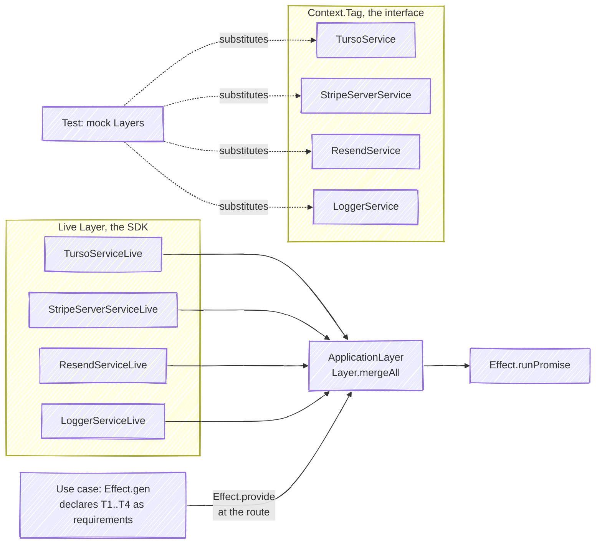

Every server-side flow that touches an external system (database, Stripe, email, logging) is written with [Effect](https://effect.website). The payoff is twofold: **typed errors** that map exhaustively to HTTP statuses, and **dependency injection** that lets tests swap real SDKs for mock layers without module mocking.

## The service pattern

Each external SDK is wrapped once, in `apps/web/src/infrastructure/clients/`, following the pattern documented in `apps/web/src/infrastructure/clients/AGENTS.md`: a `Context.Tag` declares the interface, a Live `Layer` provides the real implementation.

```ts
export class FooService extends Context.Tag('FooService')<
  FooService,
  { method(): Effect.Effect<Result, FooError> }
>() {}

export const FooServiceLive = Layer.sync(FooService, () => {
  const client = new FooSDK(config);
  return { method: () => Effect.tryPromise({ try: () => client.method(), catch: wrapError }) };
});
```

The concrete services:

| Tag | File | Wraps |
| --- | --- | --- |
| `TursoService` | `apps/web/src/infrastructure/clients/db/turso/service.ts` | `@tursodatabase/serverless`, exposing `query` and `execute` |
| `StripeServerService` | `apps/web/src/infrastructure/clients/payments/stripe/serverService.ts` | Server-side Stripe SDK |
| `ResendService` | `apps/web/src/infrastructure/clients/email/resend/service.ts` | Resend transactional email |
| `LoggerService` | `apps/web/src/infrastructure/logging/service.ts` | The `logger` object, so a use case declares logging as a requirement |

For code that runs outside Effect or without a layer to provide (pure utilities, client components, the lookups under `apps/web/src/infrastructure/services`), `apps/web/src/infrastructure/logging/logger.ts` exports the same `logger` object directly; `LoggerService` is the injected equivalent wherever a layer is provided (`E10` in [`CODING_STANDARDS.md`](https://github.com/fbuireu/forever-pto/blob/main/CODING_STANDARDS.md)).

## ApplicationLayer

`apps/web/src/infrastructure/layers.ts` merges all Live layers into one composition root:

```ts
export const ApplicationLayer = Layer.mergeAll(
  TursoServiceLive,
  StripeServerServiceLive,
  ResendServiceLive,
  LoggerServiceLive,
);
```

Whatever runs a program provides it exactly once, at the edge of that program: `Effect.runPromise(program.pipe(Effect.provide(ApplicationLayer)))`.



## Where Effect runs

- **Use-cases** (`apps/web/src/application/use-cases/`): `Effect.gen` pipelines that declare their dependencies in the type signature. `createPayment` in `apps/web/src/application/use-cases/payment.ts` is the canonical example: it validates with zod (`zodParse`), optionally applies a promo code, creates the Stripe PaymentIntent and returns typed failures (`ValidationError | PaymentError | PromoCodeError`).
- **Operations** (`apps/web/src/infrastructure/api/operations/`): `payment.ts`, `contact.ts` and `activatePremium.ts` each run one flow that has two transports. An operation takes its input as an Effect, checks the rate limit first where the flow reaches Stripe or grants Premium, runs the use case, provides `ApplicationLayer` and schedules the deferred write. It maps every failure through `describeFailure`, the one tag-to-status table in `apps/web/src/infrastructure/api/errors.ts` (for example `RateLimitError` → 429, `ValidationError` → 400, `PaymentError` → 500), with a final `Effect.catchAll` so it never rejects, and returns `{ status, body }`.
- **Route handlers**: `POST /api/payment`, `POST /api/contact`, `POST /api/check-session` and `GET /api/payment/activate` call an operation and wrap its outcome in `noStore`. `GET /api/check-session` and `POST /api/webhooks/stripe` run their own program against `ApplicationLayer`; a branch local to one route (the webhook's `WebhookError`, the `SessionError` of check-session's `GET`) stays an `Effect.catchTag` there.
- **Server actions**: `apps/web/src/infrastructure/actions/payment.ts` and `apps/web/src/infrastructure/actions/contact.ts` are thin `'use server'` wrappers around the same operations, returning the body alone instead of an HTTP response.
- **Webhook handlers**: `handlePaymentSucceeded` (`apps/web/src/application/use-cases/paymentSucceeded.ts`) and `handlePaymentFailed` (`apps/web/src/application/use-cases/paymentFailed.ts`) are use cases too, called by `processWebhookEvent`; they consume `TursoService`, `LoggerService` and, for the charge, `StripeServerService` through context like every other one. The domain imports no Effect at all.

## Deferred database writes with `after()`

Writes that must not block the response are returned by use-cases as an unexecuted `deferred` Effect. The operation schedules it with `after()` from `next/server`, which runs once the response has been sent:

```ts
const { clientSecret, discountInfo, deferred } = yield* createPayment({ params: body, context });

after(() => Effect.runPromise(deferred.pipe(Effect.provide(ApplicationLayer))));
```

All three operations do this, so the routes and the server actions share it. The deferred Effect swallows its own failures into a warning log; for payments, the Stripe webhook (`apps/web/src/app/api/webhooks/stripe/route.ts`) recreates the row if the deferred save never landed, so the database converges either way.

## Testing

Because dependencies are tags, unit tests provide mock layers instead of the Live ones, so no test calls an SDK (see `apps/web/src/infrastructure/clients/AGENTS.md`).
