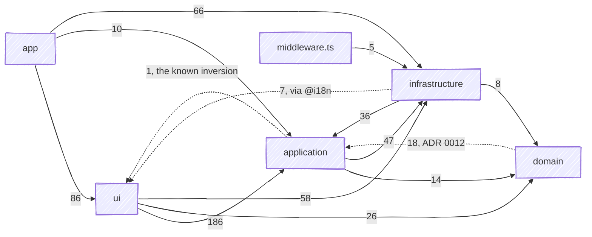

The app is organised into five layers under `apps/web/src/`, plus `apps/web/src/middleware.ts` at the root of the tree. Each layer has one responsibility, and the import graph between them is measured, not assumed. [The layers in detail](/architecture/layers/) walks each one.

## The layers

| Layer | Path | Responsibility |
| --- | --- | --- |
| App | `apps/web/src/app/` | Next.js App Router: routes, layouts, API handlers, metadata, sitemap/robots. Composition only; see [routing](/architecture/routing/). |
| Application | `apps/web/src/application/` | Data contracts (DTOs), Zustand stores, Effect use-cases, `next-intl` navigation glue (`apps/web/src/application/i18n/navigation.ts`), email templates and export generators. |
| Domain | `apps/web/src/domain/` | Pure business logic: the calendar suggestion engine (`apps/web/src/domain/calendar/`) and the payment events and statuses (`apps/web/src/domain/payment/`). |
| Infrastructure | `apps/web/src/infrastructure/` | Everything that talks to the outside world: SDK clients, services, the proxy helpers, the calculation Web Worker (`apps/web/src/infrastructure/workers/`), i18n runtime config and `.well-known` payloads. |
| UI | `apps/web/src/ui/` | React modules (`apps/web/src/ui/modules/`), hooks, styles (`apps/web/src/ui/styles/`), assets and i18n message catalogs (`apps/web/src/ui/i18n/messages/`). |

## Dependency direction

The table below is the import graph of `apps/web/src`, counted from the tree with tests excluded, as `imports/files`: how many import specifiers, in how many files, run from the row's layer into the column's. An empty cell is an edge that does not exist. `tests/docs-consistency.test.ts` fails when the table and the tree disagree in either direction, so it is a measurement rather than a drawing. A sketch of the intended layering (`app → ui → application → domain`) would leave out most of these edges, the heaviest being `app → infrastructure`.

| from / to | `app` | `ui` | `application` | `domain` | `infrastructure` |
| --- | --- | --- | --- | --- | --- |
| `app` | | 86/16 | 10/6 | | 66/23 |
| `ui` | | | 186/84 | 26/19 | 58/46 |
| `application` | | 1/1 | | 14/9 | 47/13 |
| `domain` | | | 18/13 | | |
| `infrastructure` | | 7/2 | 36/25 | 8/6 | |
| `middleware.ts` | | | | | 5/1 |

The same graph drawn: every arrow is an `imports` edge, weighted by the import count above. The three dashed arrows point upward, against the layering; the bullets below explain them.

Read the shape rather than the numbers. Four things are worth naming:

- **`app` never imports `domain`.** It is the only empty cell a reader would expect to be full, and it is the
  layering claim this package actually keeps: a route handler or a page reaches a business rule through
  `@application/use-cases/*` or through the calculations worker, never directly.
- **`domain` imports upward once, and never into `infrastructure`.** `domain → application` is the calendar
  context reaching `HolidayDTO` and the shared date helpers; that arrow points the wrong way on purpose, and
  [ADR 0012](https://github.com/fbuireu/forever-pto/blob/main/docs/adr/0012-shared-date-helpers-stay-in-the-application-layer.md)
  records what every alternative costs. The `domain → infrastructure` cell is empty: neither context imports
  Effect, an infrastructure module or a vendor SDK, a type-only import included. The payment context is the
  event types that its use cases under `apps/web/src/application/use-cases/` and its Stripe adapter under
  `apps/web/src/infrastructure/services/payments/provider/` share, which is
  [ADR 0023](https://github.com/fbuireu/forever-pto/blob/main/docs/adr/0023-the-payment-domain-is-types.md).
- **`infrastructure` imports upwards too**: imports in a couple of files reach
  `apps/web/src/ui/i18n/messages/*.json` through the `@i18n` shorthand. "Nothing in `infrastructure` imports from
  `@ui/*`" holds for the literal specifier and not for the layer, so the table counts the edge.
- **`application → ui` is a single import**, `stores/premium.ts` reaching `checkSession`, the known inversion
  `apps/web/src/application/AGENTS.md` records. One is the number; the contract suite fails a second.

The rules themselves live in [`CODING_STANDARDS.md`](https://github.com/fbuireu/forever-pto/blob/main/CODING_STANDARDS.md); this page does not restate them:

- Its *Tooling already enforces* section lists the import rules the contract suite holds the code to: what each
  domain context may import from outside itself, what the application layer may not reach, and what the UI takes
  from where. `apps/web/src/domain/AGENTS.md` says why the test for a new calendar entry is the runtime rather
  than the layer.
- `I1` to `I16` say how the outward-facing layer is built.
- `U1` and `U2` list the pure value helpers the UI may take from `@domain/calendar` and the infrastructure seams
  it may import, and why it must not reach the planning engine itself.

Two facts no import arrow carries: stores in `apps/web/src/application/stores/` never call SDK clients directly, they delegate to `apps/web/src/infrastructure/services/*`; and the server-side dependencies are composed once, in `ApplicationLayer` (`apps/web/src/infrastructure/layers.ts`), which is runtime wiring rather than an import direction ([Effect layers](/architecture/effect-layers/)). [ADR 0014](https://github.com/fbuireu/forever-pto/blob/main/docs/adr/0014-ddd-where-it-pays.md) records which domain-driven practices this tree takes, takes in part and rejects.

## An AGENTS.md per folder

Every significant folder carries its own `AGENTS.md`: the folder's map, the couplings a change there has to carry, its runtime gotchas and its guardrails. Read it before touching the folder; examples are `apps/web/src/domain/AGENTS.md` (the two contexts and their imports), `apps/web/src/infrastructure/clients/AGENTS.md` (the Effect client pattern) and `apps/web/src/application/stores/AGENTS.md` (the stores and what each persists). `GLOSSARY.md` is a different document and exists only at the repo root; a nested one is forbidden because the name would be ambiguous.

## Path aliases

The app declares them in `apps/web/tsconfig.json` (`compilerOptions.paths`), not at the repo root, whose `tsconfig.json` covers `tests/` and excludes `apps/`. `apps/web/vitest.config.ts` sets `resolve.tsconfigPaths`, so a new alias is one edit. The wiki declares only the one it needs, `@ui/*`, in `apps/docs/tsconfig.json`.

| Alias | Target |
| --- | --- |
| `@app/*` | `./src/app/*` |
| `@infrastructure/*` | `./src/infrastructure/*` |
| `@domain/*` | `./src/domain/*` |
| `@ui/*` | `./src/ui/*` |
| `@application/*` | `./src/application/*` |
| `@assets/*` | `./src/ui/assets/*` |
| `@styles/*` | `./src/ui/styles/*` |
| `@i18n/*` | `./src/ui/i18n/*` |

That is the whole list. `@assets`, `@styles` and `@i18n` all point inside `apps/web/src/ui/`: they are shorthands, not separate layers, which is why an `@i18n/...` import from `apps/web/src/infrastructure/` counts as an `infrastructure → ui` edge in the table above. The aliases carry no `baseUrl` and resolve against the `tsconfig.json` that declares them.

## Related pages

- [The layers in detail](/architecture/layers/) walks each node of the graph: what it holds, where it runs, what it may import.
- [What runs where, and when](/architecture/when-and-where/) orders the same code by moment: build, deploy, edge, page load, interaction, worker.
- [Routing](/architecture/routing/) covers how `apps/web/src/app/` is laid out.
- [Proxy](/architecture/proxy/) covers the per-request chain.
- [Effect layers](/architecture/effect-layers/) covers server-side dependency injection.
- [Caching](/architecture/caching/) covers why Cache Components are off and the R2 incremental cache.
