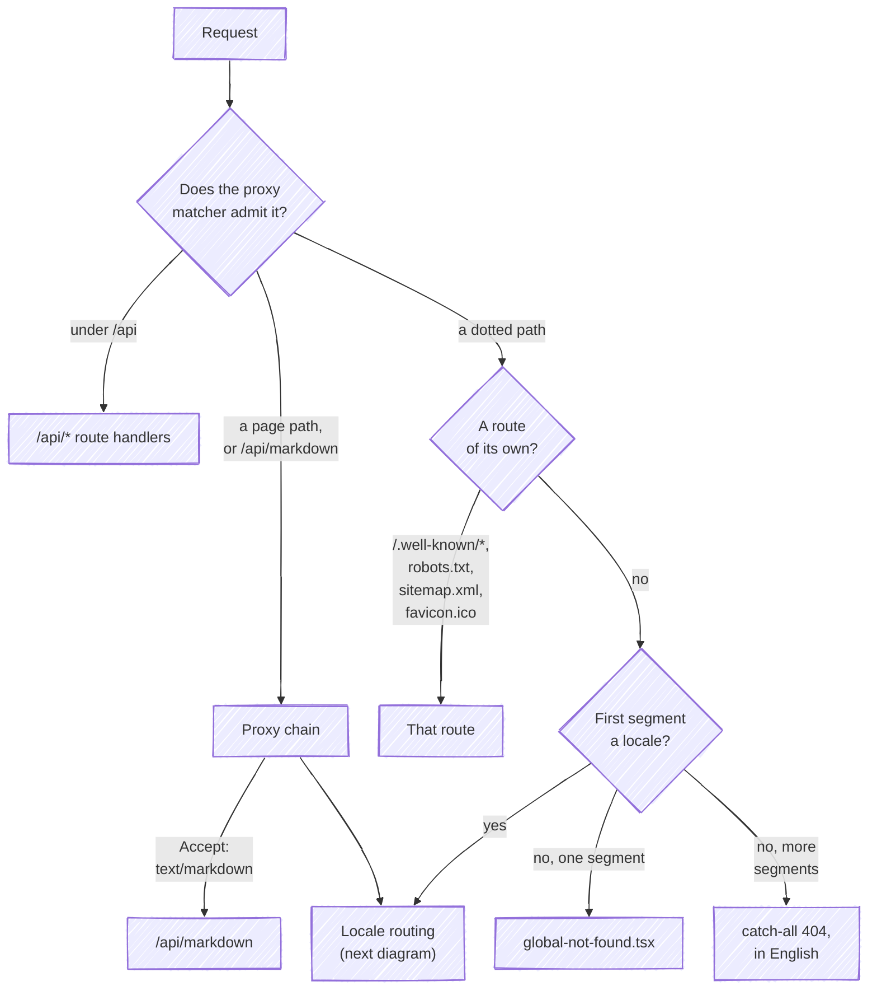
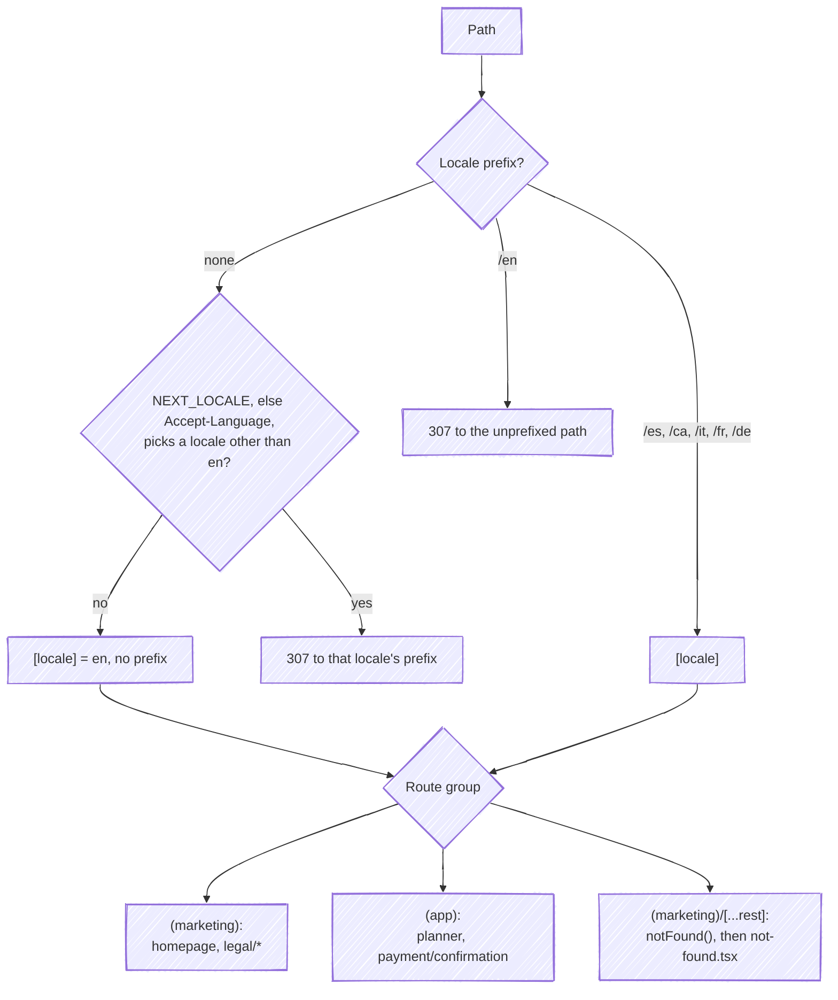

All user-facing routes live under `apps/web/src/app/[locale]/`. The locale segment is driven by `next-intl` with `localePrefix: 'as-needed'` (`apps/web/src/infrastructure/i18n/routing.ts`): the default locale (English) has no URL prefix, every other locale from `apps/web/src/infrastructure/i18n/locales.ts` gets one (`/es`, `/ca`, `/it`, `/fr`, `/de`).

## Route tree

```text
src/app/
├── [locale]/
│   ├── layout.tsx              # root layout: fonts, providers, analytics;
│   │                           # generateStaticParams over the locales, dynamicParams = false
│   ├── error.tsx               # locale-scoped error boundary
│   ├── (marketing)/
│   │   ├── page.tsx            # homepage
│   │   ├── layout.tsx          # header, footer, toaster, quick start
│   │   ├── error.tsx
│   │   ├── not-found.tsx       # the 404 view, in the request's locale
│   │   ├── [...rest]/page.tsx  # every unknown path: notFound()
│   │   └── legal/              # cookie-policy, legal-notice,
│   │                           # privacy-policy, terms-of-service
│   └── (app)/
│       ├── planner/            # the tool (sidebar layout)
│       └── payment/confirmation/
├── api/                        # route handlers (unlocalised)
├── .well-known/[...slug]/      # agent-facing discovery documents
├── global-error.tsx            # root error boundary (own <html> shell)
├── global-not-found.tsx        # static 404 for a URL no locale claims
├── robots.ts / sitemap.ts / favicon.ico / fonts.ts
```

A request reaches one of those files in two steps. First, which part of the app answers it:



Then, for a page path, which locale and route group:



A file under `apps/web/public` (`/.well-known/security.txt` among them) never gets this far: Workers Static Assets answers it before the Worker runs ([caching](/architecture/caching/)).

## Route groups

- **`(marketing)`** holds the public homepage (`apps/web/src/app/[locale]/(marketing)/page.tsx`, composed from sections in `apps/web/src/ui/modules/pages/homepage/sections/`) and the legal pages, each titled by one `routeMetadata` line. The group has its own `layout.tsx`, `error.tsx` and `not-found.tsx`, and the catch-all `apps/web/src/app/[locale]/(marketing)/[...rest]/page.tsx`, which answers every path under a locale that no other page claims by calling `notFound()`, so the 404 renders inside the group's header and footer.
- **`(app)`** holds the product itself. `planner/page.tsx` renders the planner; `planner/layout.tsx` wraps it in the sidebar shell (`SidebarProvider`, `AppSidebar`, store initialisation, premium modal, donate widget, footer). `payment/confirmation/page.tsx` reads the `payment_intent` search param and shows the Stripe payment result; requests without that param never reach it, because the [proxy](/architecture/proxy/) redirects them home.

Route groups affect layouts only, not URLs: `/planner` and `/payment/confirmation` have no group segment in the path.

## API routes

API routes live outside `[locale]` and are excluded from the proxy matcher (except `/api/markdown`).

| Route | File | Purpose |
| --- | --- | --- |
| `POST /api/payment` | `apps/web/src/app/api/payment/route.ts` | Creates a Stripe PaymentIntent (rate-limited, Effect-based) for a caller outside the page; the Donate popover runs the same operation through the `createPaymentAction` Server Action |
| `GET /api/payment/activate` | `apps/web/src/app/api/payment/activate/route.ts` | Stripe's `return_url`. Activates Premium and redirects to the confirmation page with the session cookie and the one-shot `premium-activation` proof already set, or with `activation=failed` in the address when it could not |
| `GET/POST /api/check-session` | `apps/web/src/app/api/check-session/route.ts` | Verifies / mints the premium JWT cookie; the in-page card confirmation and the *I already donated* recovery both activate through its `POST` |
| `POST /api/contact` | `apps/web/src/app/api/contact/route.ts` | Resend email + Turso record for a caller outside the page; the contact form runs the same operation through the `sendContactEmailAction` Server Action |
| `POST /api/webhooks/stripe` | `apps/web/src/app/api/webhooks/stripe/route.ts` | Stripe webhook (payment succeeded/failed fallback) |
| `GET /api/markdown` | `apps/web/src/app/api/markdown/route.ts` | Markdown rendition of a listed page. Only reachable, and only drivable, through the proxy rewrite |
| `GET /api/health` | `apps/web/src/app/api/health/route.ts` | Liveness only: answers `{ status: "ok", timestamp }`, `no-store`, and checks no dependency, so it says the Worker runs, not that Stripe, Turso or Resend answer |

`GET /api/payment/activate` grants an entitlement, so it is guarded: it requires the Stripe client secret and compares it in constant time, rate-limits on `cf-connecting-ip`, and answers `no-store` because the redirect carries a `Set-Cookie`. The redirect adds `activation=failed` when activation failed, so a failure never lets the confirmation page claim Premium is active. Only the issuer-redirect path reaches this route; a card confirmed in the page activates through `POST /api/check-session`. [Premium](/how-it-works/premium/#the-redirect-get-apipaymentactivate) has the whole flow.

## The `.well-known` catch-all

`apps/web/src/app/.well-known/[...slug]/route.ts` is a lookup table, not a router. It joins the slug segments and asks `lookupWellKnownDocument` (`apps/web/src/infrastructure/well-known/documents.ts`) for one of its exact keys (`api-catalog`, `mcp/server-card.json` and `agent-skills/index.json`), and anything else is a 404. That table is a `Map`: as a plain object it would answer `/.well-known/constructor` with an inherited `Object.prototype` function, which passes the presence guard and is then called as a handler.

**The document modules return plain objects; the route owns the envelope.** Each builder takes the base URL from the Cloudflare environment (`getCloudflareContext`) and returns a value; the route serialises it and sets the per-document `Content-Type` and the shared `WELL_KNOWN_CACHE_CONTROL` (`apps/web/src/infrastructure/well-known/slugs.ts`). A new document is a new entry in the map and nothing else. With the Markdown rewrite in the proxy, this is the app's agent-facing surface ([WebMCP and .well-known](/how-it-works/webmcp/)).

**`/.well-known/security.txt` never reaches the catch-all.** It is a static file, `apps/web/public/.well-known/security.txt`, and the static layer answers it first on both targets: `next start` serves the public folder ahead of a dynamic route, and on the Worker, Workers Static Assets answers a path that matches a file in `.open-next/assets` before the Worker runs. The handler would answer that slug with its JSON 404.

## Error and not-found surfaces

Each locale has an error boundary (`apps/web/src/app/[locale]/error.tsx`), the marketing group has its own `error.tsx` and `not-found.tsx`, and the app root has `global-error.tsx` and `global-not-found.tsx`. [Error pages](/architecture/error-pages/) covers each surface and which URL every 404 answers.

## Everything else at the app root

- `apps/web/src/app/robots.ts` and `apps/web/src/app/sitemap.ts` generate `robots.txt` and the sitemap.
- `apps/web/src/app/fonts.ts` declares the `next/font` families whose CSS variables the root layout applies.
- `apps/web/src/app/[locale]/layout.tsx` is the composition root for providers: intl client provider, theme, lazy motion, skeleton bones, the Stripe.js load, cookie consent, WebMCP and analytics.
