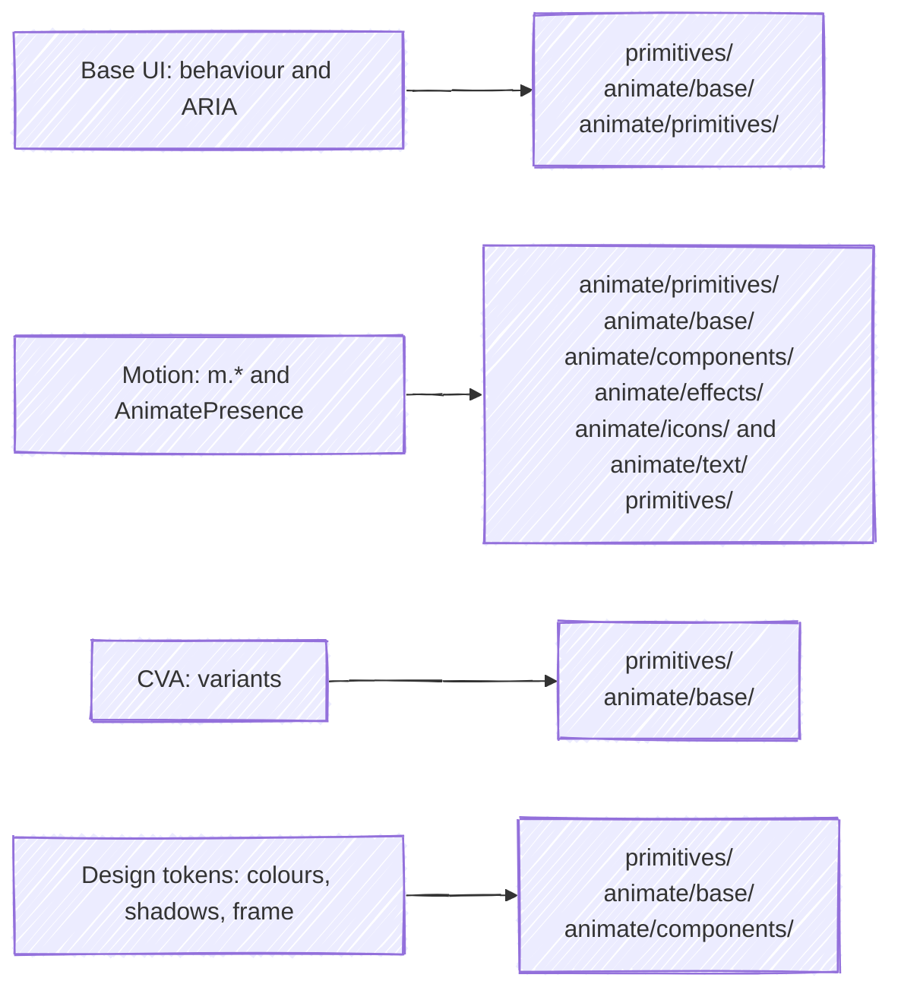
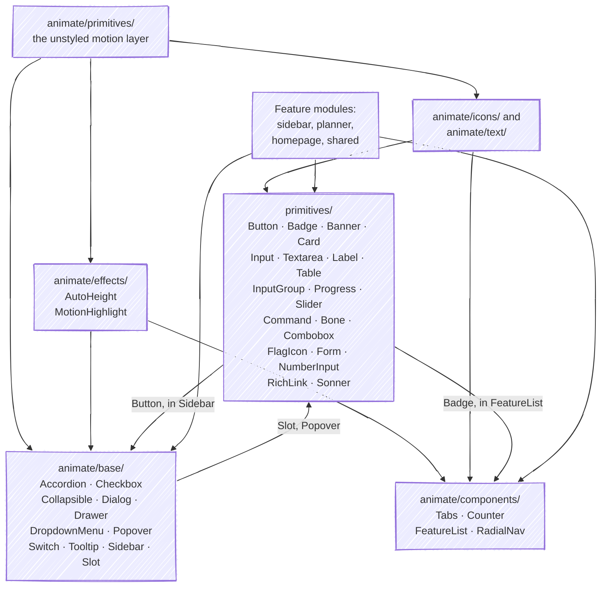

All core components live in `apps/web/src/ui/modules/core/`, and the rules they follow are in [`CODING_STANDARDS.md`](https://github.com/fbuireu/forever-pto/blob/main/CODING_STANDARDS.md): `data-slot` attributes and CVA only for orthogonal variant axes (`U11`, `U12`), and named exports and no stores, translations or fetching inside a component, which Biome and the contract suite enforce. See [Philosophy](/design-system/foundations/philosophy/) for the visual language.

Each foundation feeds some of the folders of `apps/web/src/ui/modules/core`:

Between those folders, and from the feature modules into them, the imports run like this:

An arrow points from what is imported to what imports it. `primitives/` and `animate/base/` import each other: the primitives take `Slot` and `Popover` from `animate/base/`, and its `Sidebar` takes `Button` back.

These docs import the real components through the `@ui` alias and render them as Astro islands. Portability determines what a page can show:

- **Live** means a framework-clean module (no Next.js in its import graph); the docs render the real component.
- **Live (motion)** is also portable, but built on `motion`'s `m.*` components, so `Demo.tsx` wraps every demo in `LazyMotionProvider` (`apps/web/src/ui/modules/core/animate/providers/LazyMotionProvider.tsx`).
- **Reference-only** means the module (or a transitive import) touches Next.js or app layers; documented without importing it.

## Catalog

| Component | Purpose | Portability |
| --- | --- | --- |
| [Button](/design-system/components/button/) | Primary interactive element; CVA variants and sizes, `asChild` | Live |
| [Badge](/design-system/components/badge/) | Uppercase status pill | Live |
| [Banner](/design-system/components/banner/) | Icon + title callout with brand color schemes | Live |
| [Card](/design-system/components/card/) | Surface container with Header/Title/Description/Content | Live |
| [Input](/design-system/components/input/) | Single-line field with shadow-driven states | Live |
| [Textarea](/design-system/components/textarea/) | Auto-growing multi-line field | Live |
| [Label](/design-system/components/label/) | Field caption bound to its control | Live |
| [Table](/design-system/components/table/) | Framed, scrollable data table with striped rows | Live |
| [InputGroup](/design-system/components/input-group/) | Input plus addons sharing one frame | Live |
| [Slider](/design-system/components/slider/) | Base UI slider with a track split around a bar handle | Live |
| [Accordion](/design-system/components/accordion/) | Expandable sections with animated height and rotating chevron | Live (motion) |
| [Checkbox](/design-system/components/checkbox/) | Animated check draw-in on a Base UI checkbox | Live (motion) |
| [Collapsible](/design-system/components/collapsible/) | Single show/hide region with a brutal trigger button | Live (motion) |
| [Command](/design-system/components/command/) | cmdk-based command palette list | Live (motion) |
| [Dialog](/design-system/components/dialog/) | Centered modal over a blurred gradient backdrop | Live (motion) |
| [Drawer](/design-system/components/drawer/) | vaul bottom sheet | Live (motion) |
| [DropdownMenu](/design-system/components/dropdown-menu/) | Menu with hover-following highlight | Live (motion) |
| [Popover](/design-system/components/popover/) | Anchored floating panel with spring scale-in | Live (motion) |
| [Progress](/design-system/components/progress/) | Spring-animated progress bar with overlay label | Live (motion) |
| [Switch](/design-system/components/switch/) | Animated toggle pill | Live (motion) |
| [Tabs](/design-system/components/tabs/) | Tab set with sliding highlight and auto-height content | Live (motion) |
| [Tooltip](/design-system/components/tooltip/) | Primary-colored tooltip with rotated square arrow | Live (motion) |

## Reference-only components

These cannot be imported by the docs site, because each drags Next.js or app-layer code into the bundle. They are documented by reading their source instead:

| Component | Source | Why it is coupled |
| --- | --- | --- |
| `RichLink` | `apps/web/src/ui/modules/core/primitives/RichLink.tsx` | Imports `Link` from `@application/i18n/navigation` (next-intl locale-aware routing). |
| `Sonner` (Toaster) | `apps/web/src/ui/modules/core/primitives/Sonner.tsx` | Reads the active theme with `useTheme` from `next-themes`. |
| `Combobox` | `apps/web/src/ui/modules/core/primitives/Combobox.tsx` | Typed against app DTOs (`@application/dto/*`) and `@domain/calendar/types`; composes `FlagIcon`. |
| `Sidebar` | `apps/web/src/ui/modules/core/animate/base/Sidebar.tsx` | App-shell component: cookie persistence via `apps/web/src/ui/utils/cookie.ts`, `useIsMobile` hook, keyboard shortcut wiring. |
| `Form` | `apps/web/src/ui/modules/core/primitives/Form.tsx` | react-hook-form binding (`FormProvider`, `Controller`). The dependency is not shipped with the docs site and the component only makes sense around app form flows. |
| `FlagIcon` | `apps/web/src/ui/modules/core/primitives/FlagIcon.tsx` | Renders `fi fi-{code}` spans that require the `flag-icons` stylesheet loaded by the app. |
