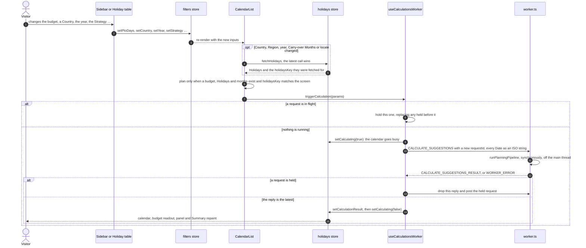
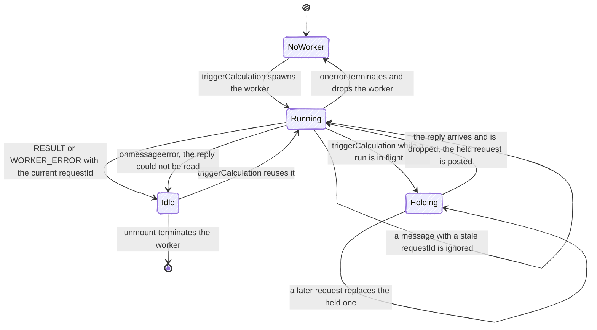
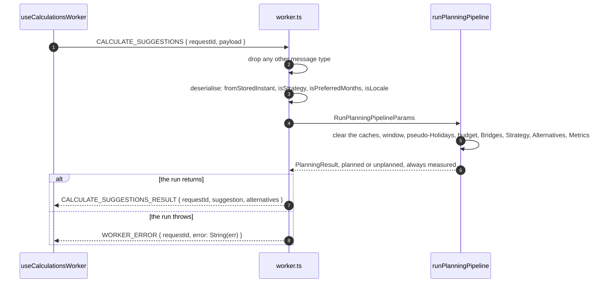

When the visitor changes anything the plan depends on (a Country, a Region, the year, the Carry-over Months, the PTO budget, the Strategy, the Preferred Months, whether past days count, or a Custom Holiday), the planner writes the new value to a store and asks a **Web Worker** for a fresh plan, so the main thread never freezes while it is computed. The worker is `apps/web/src/infrastructure/workers/worker.ts`, spawned and driven by the `useCalculationsWorker` hook in `apps/web/src/ui/hooks/useCalculationsWorker.ts`, and it runs the whole [planning pipeline](/how-it-works/planning-algorithm/).

This is a Web Worker in the browser, not a Cloudflare Worker. Nothing in that folder runs on the server, and the plan never leaves the device.

## From a change to a new plan

### What triggers a request

`CalendarList` (`apps/web/src/ui/modules/pages/planner/CalendarList.tsx`) owns the loop through two effects:

| The visitor changes | Store write | Then |
| --- | --- | --- |
| Country, Region, year, Carry-over Months, or the language | `setCountry`, `setRegion`, `setYear`, `setCarryOverMonths` in the filters store, or a new locale | `fetchHolidays` first; the calculation waits until the store's `holidaysKey` matches the screen, so a plan is never computed on the previous Country's Holidays ([holidays engine](/how-it-works/holidays-engine/#when-the-holidays-load)) |
| PTO budget, Strategy, Preferred Months, past days | `setPtoDays`, `setStrategy`, `setPreferredMonths`, `setAllowPastDays` | A calculation straight away |
| A Custom Holiday added, edited or removed | `addHoliday`, `editHoliday`, `removeHoliday` in the holidays store | A calculation: the hook's `triggerCalculation` depends on the Holiday list, so its identity changes and the effect runs again |
| An Alternative applied, or the hand edits reset | `setCurrentAlternativeSelection`, `resetManualSelection` bump `planRevision` | A calculation, from the effect that lists `planRevision` |
| A day clicked on the calendar | `toggleDaySelection` writes a Manual or Removed Day and re-measures the current plan's Metrics on the main thread | **No calculation.** The hand-edited days reach the engine only as inputs to the next run, read from the store when the request is built |

Nothing is requested before the visit's first Holiday lookup has landed (the store does not persist `holidaysKey`, so a reload never plans on the list it restored), while the budget is zero, while no Holiday is held (no Country chosen yet, or a lookup that came back empty), or while the Holidays on hand belong to other filters. When the inputs stop being plannable, a third effect clears the stored plan instead (`clearCalculation`), so the screen never shows a plan for inputs that cannot be planned.

## While it computes

The previous plan stays on screen until the new one arrives; nothing blanks. `setCalculating(true)` is what changes:

- The calendar grid is marked `aria-busy` and stops taking clicks (`pointer-events-none`), and a click that still arrives is refused as `PLAN_IN_FLIGHT`, silently, because the day it targets is about to move.
- The remaining-budget readout holds the last settled number (`usePlanReadout`), so it does not flicker through intermediate values.
- A screen reader hears *Calculating your plan*, then *Plan updated* once the reply lands.
- On the very first plan of a visit, the planner panel shows its generated skeleton until a plan exists; with a plan restored from the last visit, that plan shows at once and is replaced when the new one lands.

A run is tens of milliseconds for a year, so most visitors never notice the busy state; it matters on slow devices and while a slider is dragged.

## How a request is held or replaced

**One worker, reused, and the latest request wins.** The hook spawns the worker on its first calculation, with `new Worker(new URL('../../infrastructure/workers/worker', import.meta.url))`, the shape the bundler detects statically to emit a worker chunk, and keeps it for the life of the hook. It does not terminate the in-flight worker and spawn a fresh one on every trigger. The handler is fully synchronous, so a reused worker cannot be preempted and `terminate()` is the only thing that cancels a run, but cancelling costs more than it saves: a fresh worker starts cold, without its JIT or its cached `Intl` formatters, and measured over the real bundle it answers in about 270 ms where a warm one answers in about 60, so every recalculation would pay the difference.

So nothing cancels a run, and the hook limits how many start instead. A request made while one is in flight is **held**, and a later one replaces it, so dragging the PTO slider through a dozen values runs the first and the last and nothing in between. When the in-flight reply arrives with a request waiting, the reply is dropped and the waiting request is posted, so only the reply to the latest request ever reaches the store. `requestId` is a counter rather than a timestamp, because the replies of a reused worker are told apart by their id alone. A worker whose `onerror` fires is terminated and dropped, and the next request, a held one included, spawns a fresh one.

On unmount the hook terminates the worker, drops any held request and, if a request was still pending, clears the store's `isCalculating` flag so the UI cannot be left in a loading state with nobody to end it.

## What the worker computes

One request, one reply, correlated by the `requestId`:

The message types are the `WORKER_MESSAGE_TYPE` constant in `apps/web/src/infrastructure/workers/types.ts`, and the same file carries the wire types: `CalculateSuggestionsRequest`, `WorkerResponse` (a discriminated union of the result and the error) and the `Serialized*` shapes. A message whose type is not `CALCULATE_SUGGESTIONS` is dropped without a reply: the worker is not a dispatcher, and a second message type would be a second early return rather than an `else`.

The pipeline call and the reply sit inside a `try`/`catch`, so a run that throws still answers, with a `WORKER_ERROR`. Reading the message itself happens before the `try`: a message without a `payload` would throw in the worker and surface on the main thread as the Worker's `error` event, which the hook treats like a failed load. Only the hook sends messages, and it always sends a payload.

## How the reply reaches the screen

`setCalculationResult` in the holidays store writes the Suggestion and its Alternatives and preserves the applied Alternative index across recalculations, so a visitor who applied option three keeps option three when they nudge the budget. It also clears the Removed Days, which belonged to the plan being replaced, marks `hasCalculated`, and stamps the plan with the `holidaysKey` it was asked on, not one that loaded while it ran. Every planner component reads the store, so the calendar paints the Suggested, Manual and Alternative days, the panel shows the budget and the Alternative switcher, and the Summary renders the Metrics, in one React update. When the visitor asked for this plan (a sidebar change or an applied Alternative rather than a page load), the hook reports one `planner_generated` [analytics event](/how-it-works/observability/) with the inputs and the plan's quality, never its days.

## When it fails, or never loads

| What happens | What the hook does | What the visitor sees |
| --- | --- | --- |
| The run throws inside the worker | `WORKER_ERROR` → posts the held request, or clears `isCalculating` | The previous plan, unchanged and clickable again. Nothing is logged and no toast appears |
| The reply cannot be deserialised (`onmessageerror`) | Clears `isCalculating`, keeps the worker | The same |
| The worker chunk fails to load (offline, a chunk the previous deploy removed, a blocked script) | `onerror` terminates and drops the worker and clears `isCalculating`; the next trigger spawns a new one and tries again | A restored plan stays; on a first visit the calendar shows no plan and the panel stays on its skeleton, because no plan ever settles. Nothing is logged |
| The browser cannot construct a `Worker` at all | `new Worker` throws before the request is marked in flight, out of `CalendarList`'s effect | The locale's error boundary (`apps/web/src/app/[locale]/error.tsx`) replaces the page |
| A reply to a request a later one replaced | Ignored by its `requestId` | Nothing |
| The visitor leaves mid-run | Unmount terminates the worker and clears `isCalculating` | Nothing; the next visit plans again |

The silence of the first three is a property of the hook, which logs nothing for a worker failure; the [observability](/how-it-works/observability/) page lists what the browser does report.

## Why it is a worker at all

Generating a Suggestion, its Alternatives and the Metrics for each is the one piece of work in the app long enough to stutter a slider drag if it ran on the main thread, because a drag can ask for a plan per frame. In a worker the main thread only posts a message and later applies a result, so input, scrolling and animation keep their frame budget whatever the engine is doing. The planner computes everything in the browser by design ([ADR 0001](https://github.com/fbuireu/forever-pto/blob/main/docs/adr/0001-planner-runs-in-the-browser.md)), so there is no server to offload it to, and the worker is the browser's way to the same end. The holidays store's own `generateSuggestions` action calls the same pipeline on the main thread for the one caller without a worker, the support page's reset to defaults, and that path freezes the page for the length of one run, once.

## The boundary: every `Date` as an ISO string

`postMessage` could carry a `Date` through structured clone. The protocol deliberately does not: `SerializedHolidayDTO`, `SerializedBridge` and `SerializedSuggestion` spell every date as a string, so the boundary is an explicit, inspectable type both sides agree on, and `apps/web/src/infrastructure/workers/utils/serializers.ts` is the only module that converts in either direction. Adding a `Date` field to a domain type that crosses here means adding it to the serialiser and to the wire type, or it arrives as a string typed as a `Date`.

The way back from a string is `fromStoredInstant` (`apps/web/src/application/shared/utils/dateIntake.ts`), not `new Date`: everything crossing here was written by this app with `toISOString()`, so the instant is what round-trips, the same provenance the persistence layer has.

`Metrics` is the one domain type reused verbatim on the wire, and that is safe only while it carries no `Date`. `MetricsHoldNoDate` in `types.ts` is that claim as a type: an added `measuredAt?: Date` fails one line, in the file that makes the reuse, naming the field.

## What travels in the request

| Field | From | Notes |
| --- | --- | --- |
| `year`, `carryOverMonths` | Filters | The engine expands the Planning Window itself |
| `ptoDays` | Filters | The whole budget; the engine subtracts Manual Days |
| `holidays` | The holidays store, through `serializeHolidays` | National, Regional and Custom |
| `allowPastDays`, `strategy`, `preferredMonths`, `locale` | Filters | `strategy`, `preferredMonths` and `locale` are **narrowed** on arrival, with `isStrategy`, `isPreferredMonths` and `isLocale`, falling back to `DEFAULT_STRATEGY`, no preferred month and English, because this is the inbound leg where a value out of persisted storage arrives |
| `maxAlternatives` | The holidays store | Four |
| `manualDays`, `removedDays` | The holidays store, as ISO strings | Manual Days become pseudo-Holidays **inside the pipeline**; Removed Days are struck from the Workdays and never become Free Days |
| `autoSuggestCount` | Computed by the hook | See below |

### The auto-suggest cap

When the budget has **not** changed since the last run and the user has taken Suggested Days back, the hook caps automatic suggestions at the number of Suggested Days still active, so an edit does not hand the user replacements for the days they just removed. When the budget changed, the whole new budget is used. A computed cap of zero is treated as "no cap": the stored empty plan is what the next run reads back, and without that guard an emptied selection would pin the cap at zero for good.

## What comes back

`PlanningResult`, serialised: a measured Suggestion and its measured Alternatives. The unplanned branch (no budget, or no candidate Bridge) still carries a real `Metrics` object **measured by the engine**, sized to the Planning Window. The worker does not hand-write that object as a constant: a calendar year of monthly and quarterly buckets would differ from the engine's, which sizes both to the window, so with any Carry-over Month the empty plan would report a differently shaped `Metrics` than a real one.

## What the worker does not do

It holds **no planning rule**. Clearing the caches, building the pseudo-Holidays, deriving the window, computing the budget, short-circuiting on an empty budget and measuring each plan all live in `runPlanningPipeline`; the worker deserialises, calls and serialises. The main-thread `generateSuggestions` calls the same pipeline, which is why the two paths cannot drift: there is one orchestration, not two copies kept in step by mirrored tests.

`Temporal` reaches this thread through `temporal-polyfill`, imported explicitly by the engine rather than read off the global, because this worker is one of the realms that has to work ([ADR 0005](https://github.com/fbuireu/forever-pto/blob/main/docs/adr/0005-temporal-polyfill.md)).

## Testing

`apps/web/src/infrastructure/workers/worker.test.ts` stubs `self`, mocks `runPlanningPipeline` and drives `globalThis.onmessage` directly. It pins the boundary and only the boundary: the message-type guard, deserialisation into the pipeline's input names, the narrowings, serialisation of the reply, that an unplanned result reaches the wire with the pipeline's own `Metrics`, and that a throw becomes `WORKER_ERROR`. The pipeline's behaviour is pinned once, against the real engine, in `apps/web/src/domain/calendar/pipeline.test.ts`. The lifecycle is the hook's, and `apps/web/src/ui/hooks/useCalculationsWorker.test.ts` pins it: one worker across every run, a new id per request, a held request replaced by a later one, only the latest reply applied, a fresh worker after one fails, a stable `triggerCalculation` while only the hand-picked days change, and the plan stamped with the Holidays it was asked on. `apps/web/src/infrastructure/workers/AGENTS.md` is the folder's own guide and carries the invariants in full.
