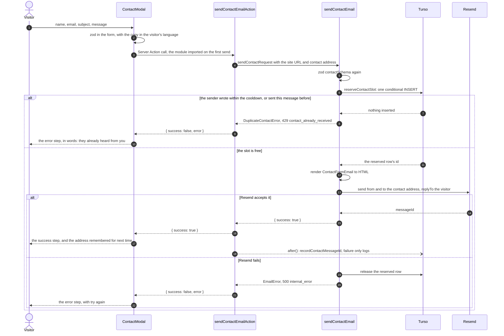

Email is deliberately minimal. There is exactly **one** email in the system today: the contact-form notification. No welcome mails, no receipts (Stripe handles its own), no marketing.

## The stack

- **Resend** as the provider, wrapped in an Effect service (`ResendService`, `apps/web/src/infrastructure/clients/email/resend/service.ts`) that is part of `ApplicationLayer` in `apps/web/src/infrastructure/layers.ts`, the same dependency-injection pattern as Turso and Stripe.
- **react-email** for templates: React components rendered to HTML on the server with the `render` the same `react-email` package exports.

## The contact pipeline

The visitor opens the contact dialog from the planner's feedback prompt, the footer or the error page; `LazyContactModal.tsx` downloads `ContactModal.tsx` only once it opens. Sending runs a **Server Action**, not a REST call:

1. `ContactModal.tsx` (under `apps/web/src/ui/modules/shared/contact/`) validates the four fields against the limits the server applies, with the copy in the visitor's language, then imports `apps/web/src/infrastructure/actions/contact.ts` and calls `sendContactEmailAction`. Next carries the call as a `POST` to the current page with the action's id in a header. The action reads `NEXT_PUBLIC_SITE_URL` and `NEXT_PUBLIC_CONTACT_EMAIL` from the Cloudflare context and hands the input to `sendContactRequest` (`apps/web/src/infrastructure/api/operations/contact.ts`), the operation `POST /api/contact` (`apps/web/src/app/api/contact/route.ts`) runs too, for a caller outside the page; the action returns the body and drops the status.
2. `sendContactEmail` (`apps/web/src/application/use-cases/contact.ts`):
   - Validates the body against `contactSchema` (`apps/web/src/application/dto/contact/schema.ts`); a zod failure answers 400 with a machine code such as `subject_too_short`.
   - Holds the sender's slot in the Turso `contacts` table with `reserveContactSlot` (`apps/web/src/infrastructure/services/contact/repository.ts`): one conditional `INSERT` that writes the row only when the same sender has written nothing inside the cooldown and never sent this message. The database evaluates it atomically, so two submissions at the same moment send one email, and the other answers 429 with the same `cooldown` or `repeated` reason a later one would.
   - Renders `ContactFormEmail` (`apps/web/src/application/email/templates/Contact.tsx`) to HTML.
   - Sends via Resend **from and to** the configured contact address, with the site visitor's address as `replyTo`, so replying in the mail client goes straight to the user, and a `category=web_contact_form` tag for filtering in the Resend dashboard.
3. **Deferred persistence**: Resend's `messageId` is recorded on the reserved row (`recordContactMessageId`). Like the payment save, this runs after the response via `next/server`'s `after()`, and a DB failure only logs, because the user's message was already delivered.

Render or send failures map to typed errors (`EmailError` → 500) and delete the reserved row, so the visitor can send again; the release is logged at `warn`, or at `error` when the row cannot be deleted. Every log line carries the email domain only, never the full address; see [observability](/how-it-works/observability/).

### What the visitor sees when it fails

The dialog has three steps, the form, success and error, and the error step always offers *try again*, which returns to the form:

| Failure | What the visitor sees |
| --- | --- |
| A field the server refuses | The error step with that field's minimum or maximum, in the visitor's language, read from the code |
| The cooldown or a repeated message | *I have already heard from you recently*, and nothing is sent |
| Resend down, or the key missing on the Worker | The generic internal-error message; the slot is released, so trying again later sends |
| Turso down | The same message: the slot cannot be reserved, so nothing is sent at all |
| The network call itself fails, offline included | The error step with the error's own words, or the generic failed-to-send copy |
| The page is older than the deploy | The Server Action is refused, and the dialog reloads the page instead of showing an error, like Donate; the visitor writes the message again on the fresh page |

The address is remembered for the next form only once a message actually went out, and the `contact_form_submitted` analytics event carries nothing the visitor typed.

## Adding a new email

The seams are already in place: add a template under `apps/web/src/application/email/templates/`, a use-case that renders and sends through `ResendService`, and provide `ApplicationLayer` at the route. Keep the pattern of deferring any DB write with `after()` and tagging the send with a `category`.
