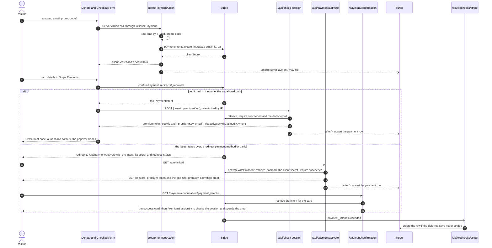

Forever PTO has no accounts and no subscriptions. Premium is **donation-based**: donate once through Stripe and the app treats you as premium. The central trick: **the premium key *is* the Stripe PaymentIntent id**. There is no separate license table: Stripe (plus a payments table in Turso) is the source of truth.

The browser never posts the Donation to a REST route. `initializePayment` in `apps/web/src/ui/adapters/payments/checkout.ts` calls the **Server Action** `createPaymentAction` (`apps/web/src/infrastructure/actions/payment.ts`), which Next carries as a `POST` to the current page with the action's id in a header. `POST /api/payment` runs the same operation, `createPaymentRequest`, for callers outside the page; the two answer alike because the operation is shared and only the transport differs.

## The Donate popover

`apps/web/src/ui/modules/shared/donate/Donate.tsx` renders the donation UI, mounted through `DonateClient.tsx` (a `dynamic(..., { ssr: false })` wrapper) in the planner layout and homepage. It combines `react-hook-form` + zod (`createPaymentSchemaWithMessages`), Stripe Elements through `StripeElementsProvider` (`apps/web/src/ui/modules/premium/StripeElementsProvider.tsx`), theming from `next-themes`, and `initializePayment` from `apps/web/src/ui/adapters/payments/checkout.ts`. The checkout itself is `apps/web/src/ui/modules/premium/CheckoutForm.tsx`. Popover open state lives in the [ui store](/how-it-works/state-stores/).

Stripe.js loads on every page, before anyone opens the checkout, because Stripe's fraud detection reads how the visitor moves through the site before a payment ([ADR 0022](https://github.com/fbuireu/forever-pto/blob/main/docs/adr/0022-stripe-js-loads-on-every-page-for-its-fraud-signals.md)). `StripePreload` (`apps/web/src/ui/modules/providers/StripePreload.tsx`), mounted once by the locale layout, asks `getStripeClientInstance()` (`apps/web/src/infrastructure/clients/payments/stripe/client.ts`) for it as the page mounts, and `StripeElementsProvider` asks the same memoised client when the checkout mounts, so the payment reuses the instance the page loaded and never fetches the script twice. When it cannot load, because a content blocker, a privacy extension or a proxy blocks `js.stripe.com`, the early ask fails quietly, the client forgets the failed load, and the checkout asks again, says the payment form could not load and offers to try again; reopening the checkout loads again too. The failure is an expected condition of the visitor's browser, so it is neither an uncaught error nor a log line. Stripe's fraud-prevention cookies, `__stripe_mid` and `__stripe_sid`, are strictly necessary, so they are set whatever the visitor answers the consent banner, and the banner and the cookie policy list them as such. The CSP admits what Stripe.js asks of it on every path: `js.stripe.com` and its subdomains in `script-src` and `frame-src`, `hooks.stripe.com` in `frame-src` and `api.stripe.com` in `connect-src`.

## Creating the payment: `createPaymentAction`

`createPaymentAction` reads the request headers and hands `createPaymentRequest` (`apps/web/src/infrastructure/api/operations/payment.ts`) the input and the context; `POST /api/payment` (`apps/web/src/app/api/payment/route.ts`) does the same from a JSON body:

1. Resolves the client IP (`cf-connecting-ip`, then `x-forwarded-for`, then `x-real-ip`) and runs the [rate limiter](/how-it-works/rate-limiting/), the platform's `PAYMENT_RATE_LIMITER` binding.
2. Delegates to the `createPayment` use-case (`apps/web/src/application/use-cases/payment.ts`): zod validation, optional promo-code resolution, then `createPaymentIntent` (`apps/web/src/infrastructure/services/payments/provider/intent.ts`) with `email`, `promoCode`, `userAgent` and `ipAddress` stored as PaymentIntent metadata.
3. Returns `clientSecret` + `discountInfo`: the route as JSON with a status, the action as the body alone.
4. The Turso `savePayment` is **not** awaited: it is a deferred Effect scheduled with `next/server`'s `after()`, provided with `ApplicationLayer` (`apps/web/src/infrastructure/layers.ts`). If it fails, a warning is logged and the webhook fallback takes over.

Typed Effect errors map to HTTP through `describeFailure`: `RateLimitError` → 429, `ValidationError`/`PromoCodeError` → 400, a `PaymentRequestError` (a payment reference Stripe refused) → 400, any other `PaymentError` → 500. The action drops the status, so the Donate popover tells a promo-code refusal by its code and shows the generic payment-failed toast for anything else. A Server Action id from a previous deploy is refused before any of this runs, and the popover reloads the page instead of reporting it ([the Server Action gotcha](https://github.com/fbuireu/forever-pto/blob/main/apps/web/AGENTS.md#gotchas)).

### Promo codes

`validatePromoCode` (`apps/web/src/infrastructure/services/payments/provider/promoCode.ts`) looks up an active Stripe promotion code (uppercased, trimmed), expands its coupon, and rejects invalid/expired/exhausted coupons with typed `PromoCodeError` codes. After applying `percent_off` or `amount_off`, the discounted total must still clear `MIN_FINAL_AMOUNT` (a constant in that file) or the code is refused; Stripe cannot charge amounts below its minimum.

## Confirming the card: in the page, or through the issuer

`CheckoutForm` (`apps/web/src/ui/modules/premium/CheckoutForm.tsx`) calls `confirmPayment` from the checkout adapter, which runs Stripe's `confirmPayment` with `redirect: "if_required"` and `return_url` set to `/api/payment/activate?locale=<locale>`. Stripe redirects only when the payment method demands it; a card, 3-D Secure included, confirms inside the page. The adapter answers one of four outcomes, and the form turns each into what the visitor sees:

| Outcome | When | What the visitor sees |
| --- | --- | --- |
| `SUCCEEDED` | Stripe confirmed in the page and `POST /api/check-session { email, premiumKey }` minted the session | Premium at once: the store mirrors the session, a toast and confetti, and the popover closes |
| `REFUSED_BEFORE_CHARGE` | The form did not validate, or Stripe refused the card | The reason in the form, and nothing charged; they can try again |
| `FAILED_AFTER_CHARGE` | Charged, but activation failed: check-session refused, answered a body the adapter does not recognise, or the request threw | A message saying the payment went through and Premium did not activate; the failure is logged with the PaymentIntent id, and *I already donated* recovers it once the payment row exists |
| `HANDED_OFF_TO_ISSUER` | Stripe resolved without an intent, because it is redirecting | Nothing in the form: the browser leaves for the issuer, then lands on `/api/payment/activate` |

`POST /api/check-session` with a `premiumKey` runs `activateWithClaimedPayment`: it retrieves the PaymentIntent, requires `succeeded`, and requires the email it was created with to be the one the browser sends, since this path carries no client secret.

## The redirect: `GET /api/payment/activate`

Stripe's `return_url`, reached only on the redirect path. `apps/web/src/app/api/payment/activate/route.ts` grants an entitlement, so it carries guards: the Stripe client secret is required and compared against the retrieved intent's own in constant time, `redirect_status` short-circuits before Stripe is called at all, the request is rate-limited on `cf-connecting-ip`, and the redirect is `no-store` because it carries a `Set-Cookie`. `activateWithPayment` does the rest: it retrieves the PaymentIntent, requires `succeeded`, mints the session and schedules the row upsert.

The route always redirects to the localised `/payment/confirmation?payment_intent=…`. On success it sets the `premium-token` cookie and the one-shot `premium-activation` proof and adds nothing to the address; on any failure it adds `activation=failed` and sets no cookie. The confirmation page renders per request: it retrieves the PaymentIntent again and shows the success card with *Premium activated*, or, under `activation=failed`, the same card with *activation failed*; a payment that did not succeed shows a failure card, *Payment failed* when Stripe reports nothing charged and *Payment not confirmed yet* otherwise. On the success path it mounts `PremiumSessionSync`, which asks `GET /api/check-session` once, and the premium store reports `premium_activated` only while the proof is unspent, spending it in the same task, so a reload reports nothing twice.

## Webhook as DB fallback: `POST /api/webhooks/stripe`

The route verifies the `stripe-signature` header, then `processWebhookEvent` (`apps/web/src/application/use-cases/webhook.ts`) handles:

- `payment_intent.succeeded`: if the payment row is missing (the deferred save failed), it **creates it from the webhook payload**, then runs the handler use case (`apps/web/src/application/use-cases/paymentSucceeded.ts`).
- `payment_intent.payment_failed`: `apps/web/src/application/use-cases/paymentFailed.ts`.

So the database converges even if the original request died after charging. What Stripe gets back decides whether it delivers again:

| Answer | When |
| --- | --- |
| 200 | Processed, or a succeeded payment with no donor email, which is logged at error level and acknowledged, because no retry can add the email |
| 400 `MISSING_SIGNATURE` or `INVALID_SIGNATURE` | The header is absent or does not verify |
| 400 `WEBHOOK_MISCONFIGURED` | `STRIPE_WEBHOOK_SECRET` is not set on the Worker; logged at error level, since redelivery cannot succeed, and Stripe marks the endpoint failing |
| 500 `WEBHOOK_PROCESSING_FAILED` | Anything else, a Turso failure included; Stripe delivers again later |

The mapping lives in the route and in `apps/web/src/infrastructure/api/AGENTS.md`.

## The session: `premium-token` cookie

A premium session is a JWT (jose, HS256, signed with `JWT_SECRET`, 30-day expiry; `apps/web/src/infrastructure/services/premium/session.ts`) carrying `{ email, paymentIntentId }`. It is stored in the `premium-token` cookie (`PREMIUM_COOKIE` in `apps/web/src/infrastructure/services/premium/cookie.ts`): `httpOnly`, `sameSite: 'strict'`, `secure` in production, 30-day `maxAge`.

`apps/web/src/app/api/check-session/route.ts`:

- **GET**: reads the cookie, verifies the JWT, returns `{ premiumKey: paymentIntentId, email }`. A token that does not verify clears the cookie and returns nulls; a configuration error, `JWT_SECRET` missing on the Worker, keeps the cookie, logs at error level and returns nulls, so a broken deploy does not sign every donor out for good. Responses are `noStore` (never cached).
- **POST** `{ email, premiumKey? }`, rate-limited like every route that grants Premium, dispatches to one of the activation paths in `apps/web/src/application/use-cases/activatePremium.ts`:
  - with a `premiumKey`, `activateWithClaimedPayment({ paymentIntentId, expectedEmail })`: the in-page confirmation above, which has no client secret to check and verifies the donor address instead;
  - without one, `activateWithEmail(email)`: the *I already donated* recovery on a new device, which looks up the latest succeeded payment for that email in Turso.

  The third path, `activateWithPayment({ paymentIntentId, clientSecret })`, belongs to `/api/payment/activate`. They are separate entry points precisely so no caller can end up running no guard at all. All three mint the JWT and set the cookie, and the browser side mirrors the result into the [premium store](/how-it-works/state-stores/), which re-checks the session after 24 hours. The recovery path grants Premium to anyone who types an address with a succeeded payment behind it, and no path revokes it; both follow from [ADR 0008](https://github.com/fbuireu/forever-pto/blob/main/docs/adr/0008-premium-derived-from-payment.md).

## When something fails

| Failure | What the visitor sees |
| --- | --- |
| Stripe.js blocked by an extension or a proxy | The checkout says the payment form could not load and offers to try again (see above) |
| The Stripe API is down when the PaymentIntent is created | A payment-failed toast; nothing is charged |
| The Stripe API is down when the confirmation page asks | *Payment not confirmed yet*, with the advice to recover by email, because the page cannot tell whether a payment it cannot read was charged |
| Turso is down | Creating and activating still work, because both read Stripe; the payment row is written later by the webhook, and a promo code's redemption cap counts nothing until then, so it admits the code. *I already donated* answers that no Premium is found for the address, until Turso is back |
| `JWT_SECRET` missing on the Worker | Activation answers 500: in the page the form says the payment went through and Premium did not activate, on the redirect path the confirmation card says activation failed. A visitor who is already Premium keeps the cookie |
| Too many attempts from one IP | The limiter answers 429 and each surface reports its own failure: a payment-failed toast, an activation that did not complete, or no Premium for the address. The limiter fails open when its binding is unavailable ([rate limiting](/how-it-works/rate-limiting/)) |
| `GET /api/check-session` unreachable | The premium store logs it and keeps the state it had, and asks again on the first visit after 24 hours |
| The page is older than the deploy | The Server Action is refused and Donate reloads the page |

## Gating features

`apps/web/src/ui/modules/premium/PremiumFeature.tsx` wraps premium-only UI: for free users it blurs the children, overlays a lock icon and opens `PremiumRequiredModal` via the store's `showPremiumModal({ feature, origin })`, which takes a `PremiumFeatureId` rather than a display string. Current premium surfaces include [calendar exports](/how-it-works/exports/) and advanced metrics.
