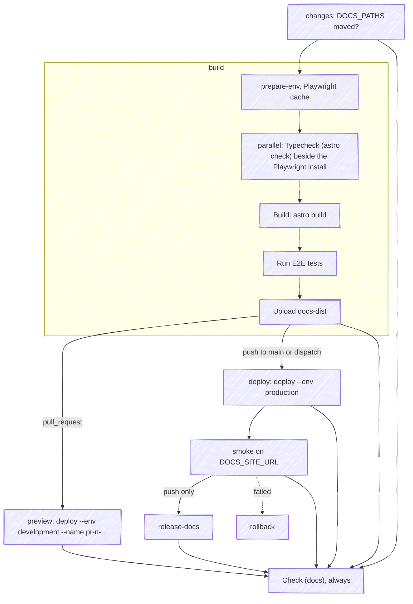

This page is self-documenting: it describes the pipeline that published it. The site is a static Astro/Starlight build served as Worker assets (`forever-pto-docs`, configured in `apps/docs/wrangler.toml`), so its CI can be far simpler than the [app's](/infra/workflows/): no runtime secrets, no database, no bindings, and a teardown that is one delete.

## The workflow



`.github/workflows/docs.yml` follows the repo's workflow conventions (SHA-pinned actions, `persist-credentials: false`, zizmor-linted). It runs on every push and pull request, and a `changes` job gates `build` on the `DOCS_PATHS` list: `apps/docs/`, `apps/web/package.json`, all of `apps/web/src/ui/`, `apps/web/src/domain/calendar/types.ts`, `apps/web/src/domain/calendar/const.ts`, `apps/web/src/infrastructure/i18n/locales.ts`, `pnpm-lock.yaml`, the workflow file and `.github/actions/`. Unrelated app changes never build the docs; changes to the reused sources do, on purpose, because they can break the demos. The list gates a `changes` job instead of filtering the trigger with `paths:`, because a filtered workflow never reports on a pull request outside its paths, so none of its jobs could be a required check.

The app entries are there because the site imports them. `app-version.ts` reads the app manifest, `HowItWorksDemo.tsx` reaches `apps/web/src/domain/calendar/types.ts` and `apps/web/src/infrastructure/i18n/locales.ts` by relative path rather than through `@ui`, and `PlanningEngineDemo.tsx` reaches `apps/web/src/domain/calendar/const.ts` the same way, so the tunables the algorithm page quotes are the engine's own. The contract suite derives that reach from the sources and fails if a path of it is missing from `DOCS_PATHS`, so the list cannot drift from what the site imports.

Triggers:

- `pull_request` → `changes`, then build & test + versioned preview when the range touches the list, and always `Check (docs)`, the aggregate the ruleset requires.
- `push` to `main` → build & test + production deploy + smoke run + release when the range touches the list.
- `workflow_dispatch` → treated as a docs change: build, deploy and smoke, which is how `ci.yml`'s `docs-refresh` rebuilds the site after a web release and how a redeploy without a commit is done.

## Build & test job

Installs the whole workspace (**unfiltered** `pnpm install`: the demos import app sources whose bare imports resolve from `apps/web/node_modules`), then runs, via the scripts in `apps/docs/package.json`:

- `pnpm typecheck`: `astro check`, which typechecks the demo islands. This is the drift tripwire: demos import real app components via the `@ui` alias with exhaustive `Record<Variant, ...>` maps, so renaming a CVA variant in the app breaks this build. It runs as one `parallel:` block with the Playwright browser install, since neither needs the other; the build waits for both.
- `pnpm build`: `astro build`; the resulting `apps/docs/dist` is uploaded as the `docs-dist` artifact for the deploy jobs.
- `pnpm test:e2e`: Playwright against a local preview server. `apps/docs/playwright.config.ts` boots `astro preview` itself via `webServer`, so no deployment is needed. Some specs are site-level smoke tests; the rest walk **every** page the build emitted a demo onto, asserting that each answers 200, that every `data-demo` frame renders something once scrolled into view, and that, once every island has hydrated, the page raises no `pageerror` and logs no `console.error`. That last assertion is the one that matters: a demo can throw during hydration and still build green, and it throws only once the island hydrates, so the spec waits for that before it asserts.

There is no Biome step here: `ci.yml`'s `Format` step checks both packages in one root pass.

## PR previews (ephemeral environments)

A docs preview is an **ephemeral environment**, one Worker per pull request, like the [app's](/infra/environments/#per-pr-previews-ephemeral-environments). It exists only for a pull request whose range touches `DOCS_PATHS`: `changes` gates `build`, and the `preview` job needs `build`, so a preview is deployed only once the typecheck, the build and the whole Playwright suite have passed against the local build, and a pull request that changes nothing the site is built from gets none. The preview job runs `prepare-env`, downloads the build artifact the `build` job already produced and deploys it as its own Worker, in the `docs-development` environment, through `cloudflare/wrangler-action` on the wrangler version `apps/docs/package.json` pins:

```bash
wrangler deploy --env development --name pr-<n>-forever-pto-docs-development
```

The `--name` override is what mints a fresh Worker rather than updating the stable one, so open pull requests never overwrite each other's preview. It resolves at:

```text
https://pr-<n>-forever-pto-docs-development.fbuireu.workers.dev
```

The `development` environment carries no custom domain, so a preview cannot answer on docs.forever-pto.com however it is deployed. Every push to the PR redeploys the same name, so the link the job posts once stays valid for the PR's whole life.

What the docs preview does *not* need is what separates it from the app's: no bindings, no `--secrets-file` on the deploy, no `--var` override, and no second build; it ships the `docs-dist` artifact.

It installs the workspace all the same, and so does the production deploy, because both run Node without building anything: the step that reads the wrangler pin is `node -p`, and `wrangler-action` starts wrangler on whatever Node the runner's `PATH` holds. Without `prepare-env` that is the Node the runner image ships, not the one `.nvmrc` pins, and the action installs its own wrangler with npm; with it, both run on the pinned Node, and the action finds the pinned wrangler already in `apps/docs/node_modules` and installs nothing.

### The URL comment

After the deploy, the same job upserts one sticky comment, found again by its hidden `<!-- docs-preview -->` marker, holding the preview URL, the branch and the head commit, beside the app's own preview comment when the pull request has both.

### Behind Cloudflare Access

The docs previews sit behind the same Zero Trust Access application as the app's, a setting of the Zero Trust dashboard that nothing in the repository declares; their hostname pattern, `pr-*-forever-pto-docs-development`, is a destination of its own on that application, and the [Cloudflare stack](/infra/cloudflare/) page says why leaving it out would let crawlers index a copy of the site.

### No E2E against the preview

The docs Playwright suite runs in the `build` job against `astro preview` serving the same `dist` the preview ships, before the preview Worker exists, so nothing runs against the deployed preview and the job needs no Access service token. A failing suite fails `build`, which skips the preview and fails `Check (docs)`.

### Teardown

`cleanup-development.yml` deletes the Worker when the pull request closes, in a `cleanup-docs` job beside the app's, retried and counted as done when the Worker does not exist, since a pull request that never touched the site never had one. A per-PR Worker that nothing tears down accumulates forever, so the same workflow's weekly `sweep`, every Monday at 03:00 UTC and on a manual dispatch, also deletes any `pr-<n>-forever-pto-docs-development` whose pull request is closed. Nothing survives a docs preview: it has no bindings, so the Worker is all the state it ever had.

The two cleanup jobs carry a concurrency group each, `cleanup-web` on `CI-...` and `cleanup-docs` on `docs-...`, the group of the workflow that deployed the Worker each one deletes. A delete therefore waits for the run that owns its Worker, the `preview` deploy included, and for no other.

## Production deploy

On `main`, the deploy job runs `prepare-env`, reuses the build job's `apps/docs/dist` artifact and runs `wrangler deploy` via `wrangler-action`, handing it the wrangler version a step reads out of `apps/docs/package.json` so they never diverge, activating a new version of `forever-pto-docs` on `docs.forever-pto.com` (an infrastructure-as-code `custom_domain` route; see [Cloudflare stack](/infra/cloudflare/)). The Worker has no script: Cloudflare serves `dist` as static assets, and `not_found_handling = "404-page"` in `apps/docs/wrangler.toml` answers a path with no file with the site's own `404.html` and a 404 status. The only credentials involved are `CLOUDFLARE_API_TOKEN` and `CLOUDFLARE_ACCOUNT_ID`; the site has no [runtime secrets](/infra/secrets/) at all. The package carries no deploy script, because one without `--env` would deploy the top-level config onto the production Worker's name without its route: a manual run of the workflow is the way to redeploy without a commit.

## Accepted cost: docs PRs still run app CI

`ci.yml` opens with a `changes` job that derives whether `apps/web` was touched, and gates `deploy-production`, `release-web` and `deploy-development` on it, so a docs-only PR deploys no app preview Worker and runs no app E2E. The `Verify` job stays unconditional, because the documentation contract suite reads `GLOSSARY.md`, `docs/adr/` and every guide and must not be skipped by a markdown-only change.

The obvious fix, `paths-ignore: ['apps/docs/**']` on the app workflows, has a branch-protection caveat: required status checks that never run **never report**, and GitHub blocks the merge waiting for them. That is why neither workflow carries a path filter: each has a `changes` job that gates its own jobs with `if:`, and an aggregate job that always reports, `Check` in `ci.yml` and `Check (docs)` in `docs.yml`, is what the ruleset requires. The redundancy that remains, the contract suite running on every pull request, is deliberate.

Related conventions for docs PRs:

- Title them for the package they touch: attribution is by path, so a `feat:`/`fix:` on a docs-only PR cuts a docs release, never an app one (see [releases](/infra/release/)).
- Docs dependencies live in `apps/docs/package.json` but share the root `pnpm-lock.yaml`, so [Renovate](/infra/renovate/) manages them under the same policy.
