The app runs as a Cloudflare Worker built with OpenNext. The kinds of environment are all defined by the `[env.*]` blocks in `wrangler.toml`: previews are not a wrangler environment of their own, they are the `development` environment deployed under a different Worker name.

| Environment | Worker | URL | Access |
| --- | --- | --- | --- |
| Production | `forever-pto` | `https://forever-pto.com` (zone route `forever-pto.com/*`) | Public |
| Development (stable) | `forever-pto-development` | `https://forever-pto-development.fbuireu.workers.dev` | Cloudflare Access; deployed by hand only |
| Per-PR preview (ephemeral) | `pr-<n>-forever-pto-development` | `https://pr-<n>-forever-pto-development.fbuireu.workers.dev` | Cloudflare Access; one per pull request that changes the app, deleted when it closes |

## Production

Deployed by the `deploy-production` job of `.github/workflows/ci.yml` on every push to `main`, gated on the `Verify` job passing and on the `changes` job finding an `apps/web` change, and on a manual `workflow_dispatch` of the same workflow, which is the only way to redeploy it by hand (see [release](/infra/release/) and [workflows](/infra/workflows/)). The Worker is bound to the `forever-pto.com` zone via a route pattern in `wrangler.toml`, a zone route, not a Workers custom domain. It uses the production R2 incremental-cache bucket, the rate-limiter binding and the Turso database (see [Cloudflare stack](/infra/cloudflare/)).

## Development (stable)

The `forever-pto-development` Worker is the long-lived development environment, and **no workflow deploys it**: CI only ever deploys the `development` environment under a `pr-<n>` name. It is updated by hand, from `apps/web`, with `pnpm cf:build` then `pnpm exec wrangler deploy --env development`, which hands off to `opennextjs-cloudflare deploy --env development` like every deploy here, fills the shared development bucket and uploads no secrets, so the Worker keeps the ones it already has. It answers on its `workers.dev` origin, which `wrangler.toml` knows only as the `NEXT_PUBLIC_SITE_URL` var under `[env.development.vars]`; there is no route for it in the file. The whole environment sits behind Cloudflare Zero Trust Access, configured in the dashboard rather than in `wrangler.toml`, so a browser hitting it gets an Access login and CI authenticates with a service token (`CF_ACCESS_CLIENT_ID` / `CF_ACCESS_CLIENT_SECRET`, secrets on the `web-development` GitHub environment).

## Per-PR previews (ephemeral environments)

A per-PR preview is an **ephemeral environment**: a Worker of its own, created for one pull request, redeployed on every push to it and deleted when it closes. Only a pull request that changes what the app is built from gets one.

### Created

The `deploy-development` job of `.github/workflows/ci.yml` runs on `pull_request` (`opened`, `reopened`, `synchronize`) once two jobs have passed: `Verify`, and `changes`, which must find a `WEB_PATHS` path in the pull request's range (`apps/web/`, `patches/`, the root `package.json`, the lockfile, `pnpm-workspace.yaml`, `biome.json`, `.nvmrc`, `.github/actions/`, and `ci.yml` and `_deploy-web.yml` themselves). The range is the whole pull request against its base, so once a pull request touches one of those paths every later push redeploys its preview, and a pull request that touches none (a docs page, an ADR) gets no app preview at all: `deploy-development`, `comment` and `e2e` are skipped, which `Check` accepts. When `changes` finds no usable base commit it fails open and deploys.

The job calls the reusable `.github/workflows/_deploy-web.yml` with `environment: web-development`, from which it derives the wrangler environment `development`, plus a `worker_name` override of `pr-<n>-forever-pto-development` and the preview's own URL, which the deploy passes to the Worker as `NEXT_PUBLIC_SITE_URL` with `--var`. The `--name` flag on `wrangler deploy` is what mints a brand-new Worker instead of updating the stable one, and `--secrets-file` on the same call is what gives it the five runtime secrets, which do not exist on a Worker until they are uploaded (see [secrets](/infra/secrets/)). A push while a run is still going cancels that run, and the next one deploys the same Worker name again.

### The URL comment

The `comment` job runs once the deploy has succeeded and upserts one sticky comment, found again by its hidden `<!-- preview-deployment -->` marker, holding the preview URL, the branch and the head commit, so a pull request carries one preview comment however often it is pushed.

### Behind Cloudflare Access

Every preview answers only through Cloudflare Zero Trust Access, an application configured **in the Zero Trust dashboard, not in `wrangler.toml`** or in any workflow, so a browser gets an Access login first and nothing crawls a preview. The repository holds only the service token CI uses to get through (`CF_ACCESS_CLIENT_ID` / `CF_ACCESS_CLIENT_SECRET`, secrets on the `web-development` environment); the hostname patterns the application covers are on the [Cloudflare stack](/infra/cloudflare/) page.

### E2E against the preview

The `e2e` job runs once the deploy has succeeded, in the `web-development` environment, with `BASE_URL` set to the preview's URL: `pnpm test:e2e` runs the whole Playwright suite, in Chromium and WebKit, against the live Worker. It authenticates through Access with the service token, which `apps/web/e2e/fixtures.ts` adds as `CF-Access-Client-Id/Secret` headers to the requests whose origin is the preview's alone, so no third party the page loads receives it, and `apps/web/e2e/warm-up.ts` requests its homepage and an unknown path once, before any worker starts, so no spec meets the Worker's first render. The report is uploaded as the `playwright-report` artifact. `e2e` is in `Check`'s `needs`, so a failing suite blocks the merge.

### Destroyed

`.github/workflows/cleanup-development.yml` fires on `pull_request: closed` (merged or not) and its `cleanup-web` job runs `wrangler delete pr-<n>-forever-pto-development --force`, retried up to five times, with an answer that the Worker does not exist counted as done, since a pull request that never touched the app never had one. That single command is the entirety of teardown: the Worker and its attached secrets disappear. It queues behind the pull request's own CI run, in the concurrency group `CI-refs/pull/<n>/merge` that `ci.yml` computes for it, so the E2E job is never left driving a Worker that no longer exists.

### The weekly sweep

The `sweep` job of the same workflow runs every Monday at 03:00 UTC and on a manual dispatch, for the deletes something else lost: it lists the account's Workers through the Cloudflare API, keeps every `pr-<n>-forever-pto-development` and `pr-<n>-forever-pto-docs-development` whose pull request is still open or cannot be read, and deletes the rest.

### What survives

Previews deploy with `--env development`, so they all **share** the development bindings: the dev R2 incremental-cache bucket, the rate-limiter binding and the dev Turso database (all declared under `[env.development]` in `wrangler.toml`). None of that state is cleaned up when a PR closes, and one preview's writes are visible to every other preview. Every preview deploy also writes its prerendered pages into that bucket under its own build id, before the Worker is uploaded ([the OpenNext hand-off](/infra/workflows/#what-the-deploy-call-does-the-opennext-hand-off)), and nothing deletes those folders, so the bucket grows by one build per deploy.

## Lifecycle

```mermaid
---
config:
  look: handDrawn
  layout: dagre
---
flowchart TD
  subgraph pr ["Pull request"]
    O["opened, reopened or synchronized"] --> GATE{"changes: a WEB_PATHS path in the range,<br/>and Verify passed?"}
    GATE -- no --> NONE["no app preview:<br/>deploy-development, comment and e2e skipped"]
    GATE -- yes --> DD["ci.yml: deploy-development"]
    DD --> RW["_deploy-web.yml"]
    RW --> B["cf:build, OpenNext"]
    B --> W["wrangler deploy --env development<br/>--name pr-n-forever-pto-development<br/>--secrets-file"]
    W --> POP["opennextjs-cloudflare deploy:<br/>pages into the shared dev bucket"]
    POP --> C["sticky PR comment with the preview URL"]
    POP --> E["e2e: Playwright through an Access service token"]
  end
  subgraph close ["Pull request closed"]
    X["cleanup-development.yml: cleanup-web, queued behind the CI run"] --> DEL["wrangler delete --force"]
    DEL --> GONE["Worker and its secrets gone,<br/>shared dev R2 and Turso untouched"]
  end
  SWEEP["sweep: Mondays at 03:00 UTC, or on dispatch"] -.->|"a preview whose pull request is closed"| DEL
  subgraph main ["push to main, or workflow_dispatch"]
    P["changes + Verify"] --> DP["deploy-production"] --> RW2["_deploy-web.yml"]
    RW2 --> W2["wrangler deploy --env production"] --> POP2["pages into the production bucket"]
    POP2 --> LIVE["forever-pto on forever-pto.com/*"]
    LIVE --> SM["smoke, then release-web on a push,<br/>or rollback when it fails"]
  end
  HAND["by hand, from apps/web:<br/>wrangler deploy --env development"] --> STABLE["forever-pto-development"]
```

## The docs site's previews (ephemeral environments)

This documentation site previews the same way, as an ephemeral environment of its own: one Worker per pull request that changes a `DOCS_PATHS` path, named `pr-<n>-forever-pto-docs-development`, behind the same Access application, deleted by its own `cleanup-docs` job when the pull request closes and caught by the same weekly sweep. What differs is what it does *not* need: no bindings, no `--secrets-file`, no `--var` override, and no second build, since it ships the `docs-dist` artifact the `build` job already produced and tested, so no E2E runs against the preview itself. [Docs CI](/infra/docs-ci/#pr-previews-ephemeral-environments) has each step.
