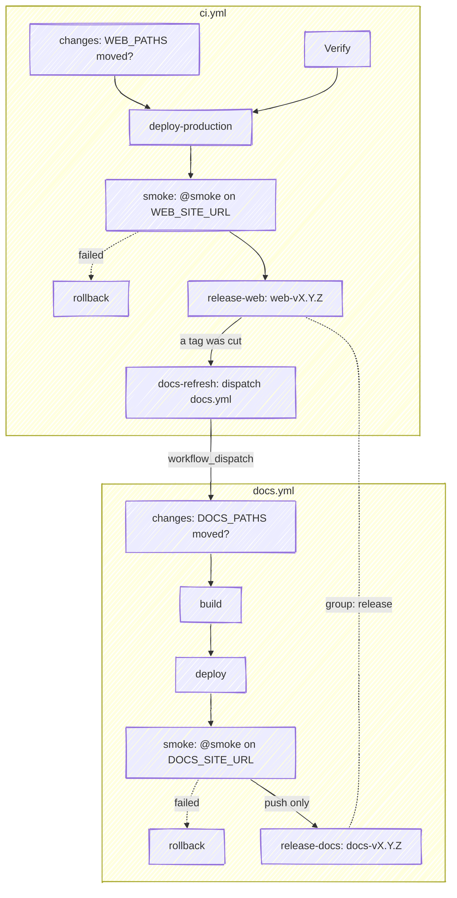

Each package releases itself. [semantic-release](https://semantic-release.gitbook.io) runs once per package, configured in `apps/web/.releaserc.json` and `apps/docs/.releaserc.json`, and [`semantic-release-monorepo`](https://github.com/pmowrer/semantic-release-monorepo) attributes a commit to a package by the paths it touches. A wiki change never cuts an app release, and an app change never cuts a wiki one.

| Package | Tags | Writes | Runs in |
| --- | --- | --- | --- |
| `apps/web` | `web-vX.Y.Z` | `package.json`, `CHANGELOG.md`, a GitHub Release | `ci.yml`, after the production deploy and its smoke run |
| `apps/docs` | `docs-vX.Y.Z` | `package.json`, `CHANGELOG.md`, a GitHub Release | `docs.yml`, after the docs deploy and its smoke run |

## The flow

`release-web` verifies that a `web-v*` tag exists, analyses the commits touching `apps/web`, writes `CHANGELOG.md` and the version bump, commits `chore(web): release x.y.z [skip ci]` and tags. `release-docs` does the same for `apps/docs` and `chore(docs): release x.y.z [skip ci]`.

1. **A release means the version is live and answering.** `release-web` needs `deploy-production` **and** `smoke`, so nothing is tagged until the deploy has succeeded and the live site has passed its smoke run; a failed smoke run rolls the Worker back instead. `release-docs` sits behind the docs deploy and its smoke run for the same reason.
2. **Attribution is by path.** `fix:` gives a patch, `feat:` a minor and `BREAKING CHANGE` a major; `docs:`, `chore:`, `ci:` and friends release nothing. The type decides how big the bump is; the files a commit touched decide which package gets it.
3. **Both packages run the same plugin chain**: release notes, `CHANGELOG.md`, the version bump in `package.json` (`@semantic-release/npm` with `npmPublish: false`, because the package is private and only the version field matters), a git commit of `package.json` and `CHANGELOG.md`, and a GitHub Release. The lockfile is not an asset: it lives two levels above the package and nothing in this chain changes it. The site displays the **app's** version, so the docs package's own version is read by nothing.
4. **The two jobs queue instead of racing.** Both declare the concurrency group `release` with `cancel-in-progress: false`. The group orders the jobs but does not move a checkout, and the checkout pins the run's sha, so the second job would hold `main` one release commit behind the remote and semantic-release would stand down, green. Each release job therefore fast-forwards onto `origin/main` first. That also covers a merge that lands mid-run: without the fast-forward, `@semantic-release/git` would push `HEAD:main` as a non-fast-forward and fail after the deploy and the smoke run passed. With it, the release covers every commit on `main` when the job runs, and the run those commits queued has nothing left to publish. A tag can therefore precede the deploy of the commits it absorbed by a few minutes. When `main` is rewritten under the run, or a merge lands in the seconds between the fast-forward and the push, the job stands down without a tag, and the run the newer head queued cuts the release over everything since the last one.
5. **`docs-refresh` closes the loop.** The release commit carries `[skip ci]`, so nothing would rebuild the wiki after an app version bump and the published header would keep showing the previous version. It runs only when `release-web` reports `released` as `true`, that is, when semantic-release cut a `web-v*` tag; a push of commits that release nothing (a `docs:` or `chore:` change under `apps/web`) ends after `release-web`. The run it dispatches builds, deploys and smoke-tests the docs site and releases nothing, because `release-docs` runs on a push alone.

The `[skip ci]` marker is load-bearing: without it, the version-bump push to `main` would re-trigger the whole graph.

## One configuration per package

`apps/web/.releaserc.json` and `apps/docs/.releaserc.json` are the same file except for `tagFormat` (`web-v${version}`, `docs-v${version}`) and the scope of the release commit message (`web`, `docs`). Both extend `semantic-release-monorepo` and state `tagFormat` explicitly, because the monorepo preset would otherwise derive it from the package name. The root `package.json` declares `semantic-release` and every plugin they name, so none resolves to a copy bundled inside `semantic-release`. The contract suite holds both files to that shape.

## The bridge tag

The app's earliest releases carry the plain `vX.Y.Z` shape. semantic-release finds the previous release by `tagFormat`, so a `web-v*` **bridge tag** sits on the commit of a plain `v*` tag of the same number. It carries the app's history across: without a tag matching `web-v*`, the next release is computed as a *first* release and published as `web-v1.0.0` over an existing line, which cannot be recalled from GitHub Releases.

A bridge tag looks like a duplicate and is not. semantic-release reads the **highest** `web-v*` tag, so deleting the wrong one moves the line. Annotate every bridge tag with its own reason, so the next reader does not have to guess ([ADR 0011](https://github.com/fbuireu/forever-pto/blob/main/docs/adr/0011-per-package-versioning-with-a-bridge-tag.md)). `release-web` has a step that fails the job when no `web-v*` tag exists at all, so the total loss is loud.

The plain `v*` tags are not part of this scheme. Neither is the floating `v1` tag: nothing moves it, and it diverges between local and remote, which makes semantic-release's own `git fetch --tags` fail with *would clobber existing tag*.

## Squash merge: the PR title is the commit

`main` receives squash merges, so the **PR title becomes the conventional commit** that semantic-release analyzes. Individual commit messages inside the PR do not affect the release, though commitlint still enforces the convention locally through Husky.

That makes squash merge load-bearing for a second reason: attribution reads the paths a commit touched, and `git diff-tree` prints nothing for a true merge commit. Enabling merge commits would make every merge release nothing, silently.

Consequences:

- **One package per pull request.** A PR spanning both packages appears in both changelogs.
- **A change confined to the repo root releases nothing**: `.github/`, `biome.json`, `docs/adr/`, `tests/`, the root manifest.
- **A documentation PR needs no `docs:` title**, because attribution is by path. The `semanticCommitType: docs` rule in `renovate.json` for `apps/docs/package.json` only keeps a docs dependency bump from reading as an app change; attribution already books it against `apps/docs`.

## Source files

- `apps/web/.releaserc.json`, `apps/docs/.releaserc.json` hold branches, tag formats and plugin chains.
- `package.json` at the root declares `semantic-release` and every plugin the two name.
- `.github/workflows/ci.yml` holds the `changes`, `release-web` and `docs-refresh` jobs.
- `.github/workflows/docs.yml` holds the `release-docs` job.
- `commitlint.config.ts` + `.husky/commit-msg` provide local enforcement of conventional commits. The hook also runs in the release jobs, whose install sets it up, and commitlint's `ignores` in `commitlint.config.ts` lets it through: its notes are semantic-release's, and a `BREAKING CHANGES` line longer than `body-max-line-length` would otherwise fail the commit after the tag exists.
