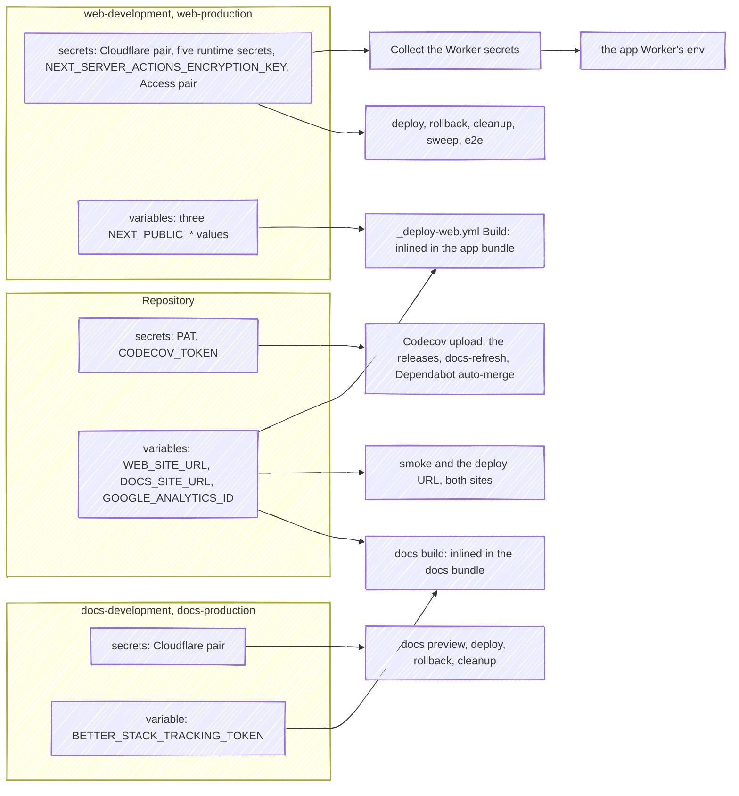

There are distinct classes of configuration, and each has exactly one home. Mixing them up is the main way deploys break.

| Class | Lives in | Reaches the app as |
| --- | --- | --- |
| Build-time public vars (`NEXT_PUBLIC_*` tokens/ids) | GitHub environment **variables**, and one repository variable | Baked into the client bundle by `cf:build` |
| Runtime secrets | GitHub environment **secrets** → `wrangler deploy --secrets-file` | Worker-attached secrets (`process.env` at runtime) |
| Non-secret runtime vars | `[vars]` / `[env.*.vars]` in `wrangler.toml` | Worker vars, committed and versioned |
| CI-only values | Repository secrets and variables, and the Cloudflare pair on every environment | Read by the workflows; never shipped |

## Secrets and variables matrix

Every `secrets.*` and `vars.*` the workflows and the composite action read, besides the implicit `GITHUB_TOKEN`:

| Name | Kind | Scope | Read by | When it is missing |
| --- | --- | --- | --- | --- |
| `CLOUDFLARE_API_TOKEN` | Secret | All four environments | `_deploy-web.yml`'s deploy, both `rollback` jobs, the docs `preview` and `deploy`, `cleanup-web`, `cleanup-docs` and `sweep` | wrangler falls back to interactive OAuth on a headless runner and times out after 120 seconds per attempt; the sweep's API call fails |
| `CLOUDFLARE_ACCOUNT_ID` | Secret | All four environments | The same jobs | The same |
| `JWT_SECRET`, `STRIPE_SECRET_KEY`, `STRIPE_WEBHOOK_SECRET`, `RESEND_API_KEY`, `TURSO_AUTH_TOKEN` | Secret, required | `web-development`, `web-production` | `_deploy-web.yml`'s *Collect the Worker secrets*, then the Worker | The guard fails the deploy job before anything ships, naming the missing ones |
| `NEXT_SERVER_ACTIONS_ENCRYPTION_KEY` | Secret, optional | `web-development`, `web-production`, the same value on both | The same guard, which adds it only when it is set, then the Worker | Nothing fails: the build generates its own closure key, so every deploy also strands the Server Actions of pages served before it until they reload |
| `CF_ACCESS_CLIENT_ID`, `CF_ACCESS_CLIENT_SECRET` | Secret | `web-development` | `e2e`, through `apps/web/e2e/previewAccess.ts` | With neither, every request meets the Access login and the run fails; with one alone the module throws |
| `PAT` | Secret | Repository, and also a Dependabot secret | `release-web` and `release-docs` (checkout and semantic-release), `docs-refresh`, `dependabot-auto-merge.yml` | No release can push its commit and tag past the `main` ruleset, `docs-refresh` cannot dispatch, and Dependabot's approve-and-merge step fails |
| `CODECOV_TOKEN` | Secret | Repository | `Verify`'s coverage upload | The upload fails and the job does not (`fail_ci_if_error: false`) |
| `WEB_SITE_URL` | Variable | Repository | `deploy-production`'s `url` (the deployment link and the Worker's `NEXT_PUBLIC_SITE_URL`), `smoke`'s `BASE_URL` | `smoke` fails its first step, which rolls back a deploy that was fine and cuts no release |
| `DOCS_SITE_URL` | Variable | Repository | The docs `deploy`'s environment URL, the docs `smoke` | The docs smoke run fails, rolls the site back and cuts no release |
| `GOOGLE_ANALYTICS_ID` | Variable | Repository | `_deploy-web.yml`'s build as `NEXT_PUBLIC_GOOGLE_ANALYTICS_ID`, the docs build as `PUBLIC_GOOGLE_ANALYTICS_ID` | Both sites build without Google Analytics |
| `NEXT_PUBLIC_STRIPE_PUBLISHABLE_KEY` | Variable | `web-development`, `web-production` | `_deploy-web.yml`'s build | `PUBLIC_ENV` fails the build: the key must start with `pk_` |
| `NEXT_PUBLIC_STORAGE_KEY` | Variable | `web-development`, `web-production` | `_deploy-web.yml`'s build | `PUBLIC_ENV` fails the build |
| `NEXT_PUBLIC_BETTER_STACK_TRACKING_TOKEN` | Variable | `web-development`, `web-production` | `_deploy-web.yml`'s build | The app builds without the browser tag |
| `BETTER_STACK_TRACKING_TOKEN` | Variable | `docs-development`, `docs-production` | The docs `build`, as `PUBLIC_BETTER_STACK_TRACKING_TOKEN` | The docs site builds without its tag |

`ci.yml` hands the deploy secrets to `_deploy-web.yml` by name, and the reusable workflow's job declares the GitHub environment, so the environment's value is the one the job sees. A job that names no environment reads an empty string from every environment secret and variable, which is why the docs `build` declares one.

**A run triggered by Dependabot or by a fork's pull request sees none of the repository's or the environments' Actions secrets**; a Dependabot run sees Dependabot secrets instead. That is why `PAT` has to be stored as a Dependabot secret too, and what it takes for a Dependabot pull request to go green is on the [workflows page](/infra/workflows/#limits-forks-and-dependabot).

## GitHub environments

The GitHub environments (`web-production`, `web-development`, `docs-production` and `docs-development`) hold the per-environment values. They are split per package so a docs deploy does not pass through whatever gate protects web production, and so the app's `NEXT_PUBLIC_*` variables are not visible to jobs that have no use for them. Only the two `web-*` environments carry those values:

- **Variables** (`vars.*`): the `NEXT_PUBLIC_*` values (Better Stack browser tag token, Stripe publishable key, storage key) that `_deploy-web.yml` injects into the build step, beside the repository's `GOOGLE_ANALYTICS_ID`. Being `NEXT_PUBLIC_*`, they end up in the public client bundle; they are *configuration*, not secrets, but still per-environment. None of them is handed to the Worker at deploy time, and the build holds no Better Stack ingest pair (a source token and an ingesting URL): the app has no tracing wrapper and no HTTP logging transport to consume one. The endpoint and the token live on the Cloudflare export destination, outside the repository entirely. What the build carries is `NEXT_PUBLIC_BETTER_STACK_TRACKING_TOKEN`, which the browser tag reads.
- **The docs site reads variables too, since it started measuring itself.** `GOOGLE_ANALYTICS_ID` is a **repository** variable, mapped by each workflow to the prefix its bundler inlines (`PUBLIC_` for Astro, `NEXT_PUBLIC_` for Next), so the measurement id is written once for both sites. `BETTER_STACK_TRACKING_TOKEN` is an **environment** variable on `docs-development` and `docs-production`, which is why the docs `build` job declares an `environment:` at all. Both are variables rather than secrets, because both are inlined into the client bundle and shipped to every browser. See [ADR 0017](https://github.com/fbuireu/forever-pto/blob/main/docs/adr/0017-observability-is-the-platform-export.md) and [ADR 0018](https://github.com/fbuireu/forever-pto/blob/main/docs/adr/0018-the-platform-is-the-log-transport.md).
- **Secrets**: `CLOUDFLARE_API_TOKEN`, `CLOUDFLARE_ACCOUNT_ID`, the runtime secrets below and the optional `NEXT_SERVER_ACTIONS_ENCRYPTION_KEY`, plus `CF_ACCESS_CLIENT_ID` / `CF_ACCESS_CLIENT_SECRET` on `web-development` for the E2E job.

This documentation site needs none of the app's `NEXT_PUBLIC_*` values, but `docs-production` and `docs-development` are not empty: `docs.yml`'s deploy, preview and rollback jobs and `cleanup-development.yml`'s docs cleanup all declare `environment:` and all read `CLOUDFLARE_API_TOKEN` from inside it. Only `PAT` and `CODECOV_TOKEN` are repository-level secrets, and `WEB_SITE_URL`, `DOCS_SITE_URL` and `GOOGLE_ANALYTICS_ID` repository-level variables. A job naming an environment that does not carry the Cloudflare credentials gets an empty string, wrangler falls back to interactive OAuth, opens a browser on a headless runner and times out after 120 seconds per attempt, so the credentials have to be copied onto all four (see [docs CI](/infra/docs-ci/) and the repository guide's setup checklist).

## Runtime secrets: uploaded with the version

The runtime secrets (`JWT_SECRET`, `STRIPE_SECRET_KEY`, `STRIPE_WEBHOOK_SECRET`, `RESEND_API_KEY`, `TURSO_AUTH_TOKEN`) are **re-uploaded on every deploy**, by the deploy itself, in `.github/workflows/_deploy-web.yml`, with `NEXT_SERVER_ACTIONS_ENCRYPTION_KEY` beside them whenever it is set:

1. A Node one-liner validates that every required one is present, failing the job before anything is deployed, and writes them as JSON to a file under `$RUNNER_TEMP` at mode `600`. Deliberately not inside the workspace: nothing an `upload-artifact` step globs can reach it there.
2. `pnpm exec wrangler deploy` takes that file on `--secrets-file`, so the secrets land on the **same Worker version** as the code that reads them.
3. An `if: always()` step removes the file.

A separate `wrangler secret bulk` call *after* the deploy would force the ordering rather than choose it: a secret write needs the Worker to already exist, so pushing first fails a new per-PR Worker with `script_not_found [code: 10007]`. The cost would be extra Worker versions on every deploy, and in the window between them the new code would run against the previous deploy's secret values. `--secrets-file` removes the second call instead of reordering it.

`--secrets-file` is additive exactly as `secret bulk` is: a key the file omits is not deleted. Re-uploading every time still makes deploys idempotent, so rotating a secret is "update the GitHub environment secret, redeploy", and the redeploy is a manual run of `ci.yml`. Preview Workers take their secrets to the grave when [cleanup deletes them](/infra/environments/).

**Nothing in the app reads a secret until a request needs it**: each client resolves its configuration inside the call and reports a missing variable as its own tagged error, so a Worker missing `RESEND_API_KEY` fails the contact form and nothing else, and one missing `JWT_SECRET` answers the session check without clearing the visitor's cookie ([premium](/how-it-works/premium/#the-session-premium-token-cookie)).

## Local development

- `.dev.vars` (gitignored) holds the local equivalents of the Worker secrets; wrangler and `initOpenNextCloudflareForDev()` pick it up automatically, and `pnpm preview` needs it. `.env.example` documents the expected keys.
- **Never commit `.env` files.** `.gitignore` carries `.env*` with `!.env.example`, and `git log --diff-filter=A` finds no `.env.development` or `.env.production` in any branch's history: the files sitting at `apps/web/` are untracked local copies.

## Conventions

- New runtime secret? Add it everywhere it is read: both `web-*` GitHub environments, the `secrets:` contract of `_deploy-web.yml` (inputs *and* the `required` list the preflight step checks), both callers in `ci.yml`, the matrix above, `.env.example`, and `environment.d.ts` for typing.
- New public build var? A `web-*` GitHub environment **variable** + the `env:` block of the build step in `_deploy-web.yml`, plus its schema in `PUBLIC_ENV` (`next.config.ts`), its type in `environment.d.ts` and its row above.
- Non-secret, per-environment runtime value (URLs, feature toggles)? `wrangler.toml` vars: committed, reviewed, no ceremony.
