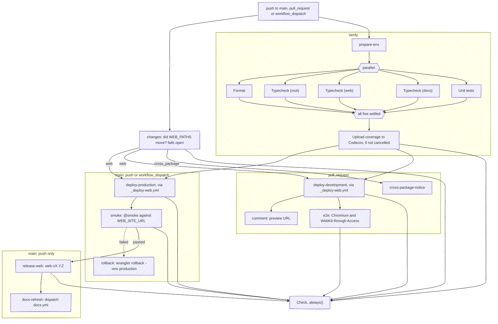
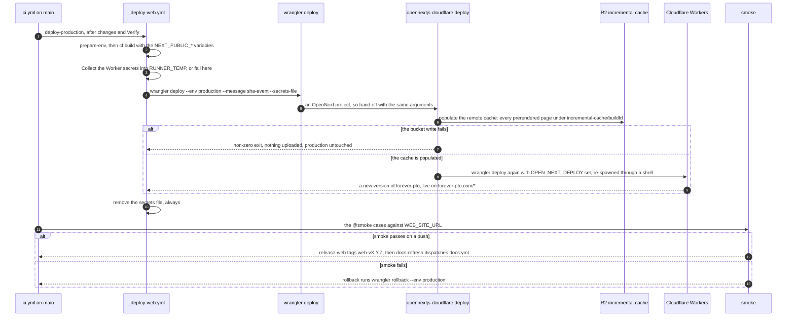
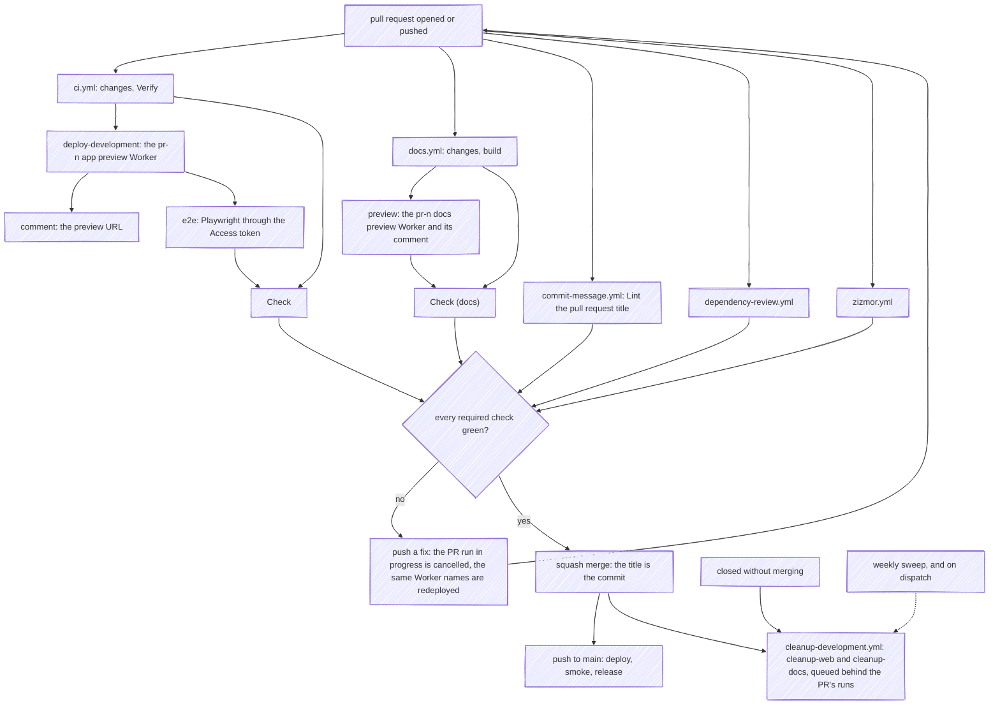

All workflows live in `.github/workflows/`, and the one composite action in `.github/actions/prepare-env`. Repo-wide conventions: every action from another repository is pinned to a full commit SHA with its version in a trailing comment, no YAML file in the repository carries any other comment (a tool directive and the line Renovate writes into `pnpm-workspace.yaml` aside; the reason for a line goes in the commit, the pull request, an ADR or a rule, and a trap goes in the root `AGENTS.md`'s *Gotchas*), and every checkout uses `persist-credentials: false`. The contract suite holds the first two and zizmor the third.

This page is the CI/CD guide's hub. The secrets and variables every job reads are a matrix on [secrets & configuration](/infra/secrets/), the Workers each deploy creates and deletes are on [environments](/infra/environments/), the versioning is on [releases](/infra/release/), and this site's own pipeline is on [docs CI](/infra/docs-ci/).

| File | Trigger | Purpose |
| --- | --- | --- |
| `ci.yml` | push to `main`, PRs to `main`, manual dispatch | The whole app graph: change detection, one `Verify` job running the checks `pnpm verify` chains as parallel steps, both deploys, the E2E run, the production smoke run and its rollback, the web release, and a `Check` job that aggregates the gated ones |
| `_deploy-web.yml` | `workflow_call` | Reusable OpenNext build + deploy, with the Worker secrets riding the deploy |
| `cleanup-development.yml` | PR closed, weekly schedule, manual dispatch | Delete the per-PR preview Workers, and sweep any left behind |
| `docs.yml` | push to `main`, PRs to `main`, manual dispatch | This site's build, checks, preview, deploy, smoke run, rollback and release, gated by its own `changes` job and aggregated under `Check (docs)` |
| `zizmor.yml` | push to `main`, all PRs | Workflow security linting |
| `dependency-review.yml` | all PRs | Fails a PR that introduces a dependency with a known vulnerability |
| `commit-message.yml` | PR opened/edited/reopened/synchronize | commitlint on the **pull request title**, the string a squash merge commits |
| `dependabot-auto-merge.yml` | Dependabot PRs | Fires for security updates; Renovate handles version updates |
| `.github/actions/prepare-env` | `uses:` in every job that installs | The composite action: checks `.nvmrc`, sets up pnpm and Node, installs the whole workspace |

## The pipeline

One push to `main`, one pull request or one manual dispatch starts `ci.yml`, and with it `docs.yml` (on [docs CI](/infra/docs-ci/)) and the checks that stand alone. Inside `ci.yml`, `changes` and `Verify` start together; `Verify` installs once and then runs its five checks as one `parallel:` block, so the job takes as long as the slowest check. Every deploy waits for both.

- **The checks are steps, not jobs.** One checkout and one install feed all five, and each reports its own log and status inside the job; `Verify` fails when any of them fails. `pnpm verify` runs the same scripts one after another for a local run.
- **A dispatch is a redeploy.** It runs `deploy-production`, `smoke` and, when the smoke run fails, `rollback`; `release-web` is push-only, so a dispatch versions nothing.
- **`Check` aggregates the gated jobs**: `changes`, `Verify`, `deploy-development`, `e2e`, `deploy-production`, `smoke` and `release-web`. `comment`, `cross-package-notice`, `rollback` and `docs-refresh` sit outside it, so a failed preview comment or notice never blocks a merge, and a rollback only ever follows a smoke run that already turned `Check` red.

## `ci.yml`: CI

Runs on pushes to `main` and PRs targeting `main`. `cancel-in-progress` is conditional on `pull_request`: cancelling a superseded PR run is free, cancelling a `main` run would kill a deploy or a release halfway.

- **changes**: derives from `git diff` whether `apps/web` (or anything the app build depends on, `WEB_PATHS`) was touched, and whether the range touches both packages, and exposes both as outputs. It uses `git diff` rather than a filter action because every third-party action here is SHA-pinned and an unpinnable one trips zizmor. It fails open: with no usable base commit it answers `web=true`.
- **Verify**: `prepare-env`, then one `parallel:` block of five steps, the scripts `pnpm verify` chains: `Format` (`pnpm format:check`, Biome with no writes), `Typecheck (root)` (`pnpm typecheck:root`), `Typecheck (web)` (`pnpm --filter forever-pto-web typecheck`), `Typecheck (docs)` (`pnpm --filter forever-pto-docs typecheck`, which is `astro check`) and `Unit tests` (`pnpm test:ut:coverage`: `apps/web`'s Vitest run with coverage, then the contract suite). After the block, under `if: ${{ !cancelled() }}`, the coverage upload to Codecov from `apps/web/coverage/lcov.info` runs whether the checks passed or not, with `fail_ci_if_error: false`, so a Codecov outage never blocks CI. `pre-push` runs the weaker `pnpm verify:changed`, since the coverage floor cannot hold over a changed-only subset, so a green push is not a promise of a green `Verify`.
- **deploy-production → smoke → release-web → docs-refresh** on a push to `main`, with **smoke → rollback** when the smoke run fails; a dispatch runs the first two and the rollback. **deploy-development → comment / e2e** on a PR. `cross-package-notice` hangs off `changes` on a pull request whose range touches both packages, and upserts an advisory comment.
- **smoke**: the only job that requests `https://forever-pto.com` itself. `e2e` runs against a per-PR preview and only on `pull_request`, so without this job a push to `main` would deploy production and cut a tag without a single request to the live site. It runs Playwright with `--grep "@smoke"`, no Cloudflare Access headers (production is public) and no `environment:` of its own. The tagged cases all live in `apps/web/e2e/smoke.spec.ts`: the homepage, the 404 route, `robots.txt` and `/.well-known/security.txt`, which has to answer as plain text with a contact and an `Expires` still ahead. That last case also wants the body byte for byte the file in the package's `public/`: a `security.txt` the Cloudflare zone serves itself answers before the Worker, and the case is what notices one standing in for the repository's. It is the same set every sibling repository runs, and the docs site's `smoke` job runs it against `DOCS_SITE_URL`, so a difference between them is drift. They are kept in one file because a failing smoke case rolls production back, so the set that holds that power has to be readable in one place. `/sitemap.xml` and `/api/health` stay out of the set: they answer 403 to a GitHub runner while a browser gets the expected response, so a case on either would revert a deploy that was fine. A case whose result depends on the caller's address is evidence about the caller, not about the deploy. The step passes no `--pass-with-no-tests` on purpose, so a grep that stops matching fails rather than passing quietly, and `release-web` needs this job as well as the deploy, so a tag means the version is live and answering. An empty `WEB_SITE_URL` fails the job's first step, which then rolls back a deploy that was fine, because Playwright would otherwise fall back to `localhost` and pass.
- **rollback**: runs `wrangler rollback --env production` from `apps/web` when the deploy succeeded and `smoke` failed, so a version that does not answer stops serving rather than only going untagged. Unlike `smoke` it declares `environment: web-production`, because rolling back needs the Cloudflare credentials. The previous version still finds its pages in the R2 cache, because every build writes under its own build id (see below). Nothing runs after a failed rollback: production keeps serving the version that failed its smoke run until someone runs the same command by hand or a fix reaches `main`.

`Check` is what the ruleset gates PRs on, and it is an aggregate: it runs under `always()` and fails when any job it needs failed or was cancelled, while a job skipped by its own `if:` counts as success. That is what makes the preview E2E run a gate without naming it, which could not be done: every job is conditional on the event, and a required check that never reports blocks the merge forever. `Verify` runs unconditionally, because the contract suite reads `GLOSSARY.md`, `docs/adr/` and every guide, so a markdown-only change must not slip past it; only the deploy and release jobs consult `changes`, and deploying is gated on `Verify` too, so a tag means the version is live. Package scoping uses step-level `working-directory`, because a job-level default would not reach a `uses:` step, which is why the two `nick-fields/retry` commands left in the tree, both in `cleanup-development.yml`, begin with an explicit `cd`.

**When a deploy step fails**, `smoke`, `rollback` and `release-web` are skipped, `Check` is red, and production keeps serving the version it had: nothing is activated until wrangler's own deploy succeeds.

## `_deploy-web.yml`: Deploy web (reusable)

A `workflow_call` workflow shared by both deploy entry points. Inputs: `environment` (GitHub environment name, `web-<stage>`; the wrangler `--env` is its stage half, derived in the workflow so a caller cannot pair `web-production` with `development`), optional `url` (shown on the PR/deployments UI, and passed to the Worker as `NEXT_PUBLIC_SITE_URL`) and optional `worker_name` (the per-PR override). Steps:

1. `prepare-env`, then build with `pnpm run cf:build` (OpenNext). The build step receives four GitHub *variables*: `NEXT_PUBLIC_BETTER_STACK_TRACKING_TOKEN`, `NEXT_PUBLIC_STRIPE_PUBLISHABLE_KEY`, `NEXT_PUBLIC_STORAGE_KEY` and `GOOGLE_ANALYTICS_ID` as `NEXT_PUBLIC_GOOGLE_ANALYTICS_ID`. These are baked into the client bundle at build time, and `PUBLIC_ENV` in `next.config.ts` fails the build on a missing storage key or a Stripe key that does not start with `pk_`. It is a plain `run:` step: a build fails deterministically, so wrapping it in `nick-fields/retry` only burned three identical attempts before reporting the same type error.
2. A Node guard fails the job if any required runtime secret is missing, rather than deploying a half-configured Worker, and writes them, plus `NEXT_SERVER_ACTIONS_ENCRYPTION_KEY` when it is set, as JSON to a file under `$RUNNER_TEMP`. See [secrets](/infra/secrets/).
3. `pnpm exec wrangler deploy --env <stage> --message <sha>-<event> --secrets-file <file>`, adding `--name <worker_name>` and `--var NEXT_PUBLIC_SITE_URL:<url>` when set; the name override is what creates a fresh per-PR Worker. The secrets ride the deploy, so they land on the same Worker version as the code that reads them, where a separate `wrangler secret bulk` call would make a second version and leave a window in which the new code runs against the old values.
4. An `if: always()` step removes the file.

### What the deploy call does: the OpenNext hand-off

`wrangler deploy` in `apps/web` does not upload the Worker itself. It finds a `next.config.*` beside `wrangler.toml`, takes the folder for an OpenNext project, and runs `opennextjs-cloudflare deploy` with the same arguments instead. That command fills the incremental cache first and only then calls wrangler again to upload:

- **The cache population is part of the deploy.** `opennextjs-cloudflare deploy` provisions the bucket bound as `NEXT_INC_CACHE_R2_BUCKET` in the chosen environment if it does not exist, then writes every prerendered page into it under `incremental-cache/<build id>/`. A failed write throws, so the job fails before any version is uploaded and the live Worker is untouched. The pages the Worker serves come from this step: when the keys it writes and the keys Next reads disagree, every page answers 404 ([caching](/architecture/caching/)).
- **Each build writes under its own build id, and nothing in this repository deletes old ones.** A rollback therefore finds the pages of the version it returns to, and a version never reads another's keys. The cost is accumulation: every preview deploy adds a build's worth of keys to the shared development bucket, and every production deploy one more folder to production's.
- **Why `--message` is one token.** OpenNext calls wrangler back with an environment variable of its own set, which stops wrangler from handing off a second time, and through a shell, so the arguments are joined and split again: a message with a space would arrive as two arguments. Every deploy in the repository passes `<sha>-<event>`, and the contract suite holds them to it.

### The deploy jobs

`deploy-development` calls `_deploy-web.yml` with the `pr-<n>-forever-pto-development` name override, then `comment` upserts a sticky preview-URL comment keyed on a hidden HTML marker and `e2e` runs Playwright in Chromium and WebKit against the live preview through a Cloudflare Access service token that reaches the preview's origin alone, uploading its report as an artifact. The workflow's concurrency group cancels in progress on a `pull_request` event only, so rapid pushes deploy just the latest commit while a `main` run is never killed halfway. The full lifecycle is on the [environments](/infra/environments/) page.

`ci.yml` also answers `workflow_dispatch`: a manual dispatch on `main` runs `deploy-production` with `smoke` behind it, which is how a rotated credential reaches what actually runs. Every one of them is read at build or deploy time (Worker secrets through `--secrets-file`, public variables inlined by the build), so rotating a value changes no file and matches no path filter; without the dispatch the old value stays live until an unrelated commit comes along. The Better Stack credentials are the exception and need no dispatch: they live on the Cloudflare export destination rather than on the Worker. A dispatch cuts no release: `release-web` stays push-gated, since redeploying the same sha versions nothing, and a release the push-triggered job stood down on is cut by the run for `main`'s next head, see [release](/infra/release/). The push-triggered jobs keep their gates. It is also the only way to deploy production by hand: the app has no deploy script, because one without `--env` would ship the top-level config.

`deploy-production` calls the same reusable workflow with `environment: web-production` and `url` taken from the `WEB_SITE_URL` repository variable, and no `worker_name` override, so it updates the `forever-pto` Worker in place. It `needs: [changes, verify]`, so a red `main` does not ship and a docs-only commit does not redeploy. See [release](/infra/release/).

## A pull request, from push to cleanup

A docs-only pull request takes the same path with the app's deploy, comment and E2E skipped by `changes`, and an app-only one skips the docs `build` and `preview`; the two aggregates report either way. Renovate's pull requests are branches of this repository, so they get every secret and preview like any other; Dependabot's and a fork's do not, see [limits](#limits-forks-and-dependabot).

## `cleanup-development.yml`: Cleanup - Development

On `pull_request: closed`, a job each: `cleanup-web` deletes `pr-<n>-forever-pto-development` and `cleanup-docs` deletes `pr-<n>-forever-pto-docs-development`, both through `nick-fields/retry` wrapping `pnpm exec wrangler delete --force`. That is the one place the retry wrapper is still right: the call is idempotent, its argument is a name the workflow composes rather than a flag, and it already treats *does not exist* as success. Shared dev R2 and Turso state is intentionally left alone.

Each job declares its **own** group, with `cancel-in-progress: false`, spelled from the pull request number and the name of the workflow that deployed the Worker it deletes: `CI-refs/pull/<n>/merge` for `cleanup-web`, `docs-refs/pull/<n>/merge` for `cleanup-docs`. Those are literally the groups the two deploying runs occupy for that pull request, so GitHub holds the delete until the run using the Worker has finished. It is not spelled from `github.ref`, which on a closed pull request is the base branch rather than the merge ref: the cleanup would join the push's run instead, delete the Worker under the E2E job and be cancelled whenever two merges come close together; see [environments](/infra/environments/). A third job, `sweep`, runs every Monday at 03:00 UTC and on dispatch, lists the account's Workers through the Cloudflare API and deletes every preview Worker whose pull request is closed, keeping one whose pull request it cannot read, for the cleanups something else still loses.

## `docs.yml`: Docs

CI/CD for this documentation site. It runs on every push and pull request, like `ci.yml`, and a `changes` job of its own gates `build` on `DOCS_PATHS`: `apps/docs/**` plus everything the site reaches into the app for, `apps/web/src/ui/**`, `apps/web/package.json` (the version the site displays), `apps/web/src/domain/calendar/types.ts`, `apps/web/src/domain/calendar/const.ts` and `apps/web/src/infrastructure/i18n/locales.ts`. It is not path-filtered on that list, because a filtered workflow does not report on a pull request outside its paths and so could never be a required check; a `Check (docs)` aggregate reports on every pull request and is what the ruleset names. Its `build` job runs a `parallel:` block of its own: the typecheck beside the Playwright browser install. It also answers `workflow_dispatch`, which is how `ci.yml`'s `docs-refresh` job rebuilds the site after a web release: the release commit carries `[skip ci]`, so without the dispatch the published site keeps advertising the previous version. It also carries `release-docs`, which runs after the docs deploy **and** its `smoke` job, so a `docs-v*` tag only exists once the site is live and answering, and `rollback`, which reverts the Worker when that smoke run fails. Build & test, versioned PR previews and production deploy of the `forever-pto-docs` Worker; the full walkthrough and its diagram are on [docs CI](/infra/docs-ci/).

## `commit-message.yml`: Commit Message

Runs commitlint on the **pull request title**, not on the branch's commits. `main` takes squash merges and the repository sets the squash title to `PR_TITLE`, so that title is the message that lands and the one semantic-release parses. The `commit-msg` hook validates commits the squash then discards, which makes this the only guard on the string that ships, and GitHub pre-fills the title from the *branch name* whenever a PR carries more than one commit, so the default is rarely conventional.

It re-runs on `synchronize` even though a push cannot change the title: required status checks are evaluated against the head SHA, so without it a new commit would leave the check unreported and block the PR.

## `dependency-review.yml`: Dependency Review

Fails a PR that introduces a dependency with a known vulnerability, reading the lockfile diff. Runs on every PR and needs no secrets.

## `zizmor.yml`: Security Analysis with zizmor

Runs the zizmor GitHub Actions security linter on pushes to `main` and every PR, reporting to GitHub code scanning (`security-events: write` is its only permission). This is what makes the SHA-pinning and `persist-credentials: false` conventions stick: any new workflow (including docs ones) gets linted too. It reads the `parallel:` blocks in `ci.yml` and `docs.yml` as well; zizmor marks its support for them experimental, and it finds nothing in them.

## `dependabot-auto-merge.yml`

Approves and auto-squash-merges Dependabot patch and minor PRs, plus an indirect or dev dependency that `fetch-metadata` gives no update type. A major is never merged here, whatever the dependency: it is commented on and labelled `review-required`. Every PR is labelled by update type. **It is not dormant.** There is no `.github/dependabot.yml`, so Dependabot opens no version-update PRs here, which is Renovate's job. But the **security** updates GitHub raises from its own vulnerability alerts need no config file, they arrive as `dependabot[bot]`, and `fetch-metadata` reports them with the same `version-update:semver-patch` and `-minor` types the auto-merge branch accepts. So the guard does match, and this is the repository's only unattended auto-merge path: it runs `gh pr review --approve` and `gh pr merge --auto --squash` under `secrets.PAT`. Do not read it as safe to ignore, and see [limits](#limits-forks-and-dependabot) for the secrets a Dependabot run can see.

## Secrets and variables

Every `secrets.*` and `vars.*` a workflow or the composite action reads, with its kind, where it is stored, which job reads it and what breaks without it, is one table on [secrets & configuration](/infra/secrets/#secrets-and-variables-matrix). `GITHUB_TOKEN` is the only implicit one.

## `.github/actions/prepare-env`: Prepare environment

The composite action every job that installs dependencies calls first, after its checkout. It takes no inputs, and runs four steps:

1. **Verify `.nvmrc` is present**, failing with an error annotation if it is not: it is what every job installs Node from.
2. **Setup pnpm** with `pnpm/action-setup`, which reads the version from the root `packageManager`.
3. **Setup Node.js** with `actions/setup-node`, `node-version-file: .nvmrc` and the pnpm store cache.
4. **Install dependencies** with `pnpm install --frozen-lockfile`, **unfiltered**: the docs demos compile app sources whose bare imports resolve from `apps/web/node_modules`, so a filtered install breaks the docs build. The contract suite holds it to being the only setup step with an unfiltered install.

Jobs call it as `uses: $/.github/actions/prepare-env`, and `ci.yml` calls the reusable deploy as `uses: $/.github/workflows/_deploy-web.yml`. The `$/` prefix names a path in the repository the workflow itself runs from, at the commit being run, which is GitHub's self-repository reference: it resolves without depending on the checkout, where the older `./` form is relative to the job's workspace and needs the checkout step to have run, into the default path, first. A change under `.github/actions/` matches both `WEB_PATHS` and `DOCS_PATHS`, so it rebuilds and redeploys both packages.

## Rulesets and required checks

Branch and tag protection are three repository rulesets, settings rather than files:

| Ruleset | Applies to | Rules |
| --- | --- | --- |
| `main` | the default branch | No deletion, no force-push, linear history; a pull request with zero required approvals and squash as the only merge method; the five required checks below. Repository admins bypass it |
| `release-tags` | `web-v*` and `docs-v*` tags | No deletion and no force-move, so a published version cannot be rewritten |
| `tags` | every tag | No deletion and no force-move; deploy keys bypass it and admins are exempt |

The required checks on `main` are `Check`, `Check (docs)`, `Lint the pull request title`, `Dependency Review` and `zizmor`, the check zizmor's code-scanning report raises. They are not strict, so a branch behind `main` can merge without updating first. `Check` and `Check (docs)` stand in for every job their workflows gate, which is why a job that must block a merge goes in an aggregate's `needs` rather than into the ruleset. The release jobs push their version commit straight to `main` with `PAT`, a token of the repository's admin, which the `main` ruleset lets through; `GITHUB_TOKEN` could not push past it, and a push it made would trigger no workflow.

## Limits: forks and Dependabot

- **A pull request from a fork gets no repository or environment secrets**, and a read-only `GITHUB_TOKEN`. Its `Verify` runs, but `deploy-development` fails before anything is deployed, at the secrets guard if not sooner, because every runtime secret it checks is empty, so `Check` is red, and the docs `preview` cannot authenticate to Cloudflare, so `Check (docs)` is too. A fork's change lands by being pushed to a branch of this repository and opened from there.
- **A run Dependabot triggers sees Dependabot secrets only**, never the repository's or an environment's Actions secrets. `PAT` therefore has to be stored as a Dependabot secret as well as an Actions one, or `dependabot-auto-merge.yml` fails at its approve-and-merge step. The same holds for every secret the preview path reads: a Dependabot pull request that touches `WEB_PATHS` deploys a preview, and without the Cloudflare pair, the five runtime secrets and the Access token stored as Dependabot secrets too, `deploy-development` fails its guard and `Check` stays red, so the auto-merge never lands. Repository settings are not readable from the tree, so which of them are stored there is the owner's to check.
- **Renovate is not limited**: its pull requests are branches of this repository, opened by the Renovate app, so they run with every secret, preview and check.
